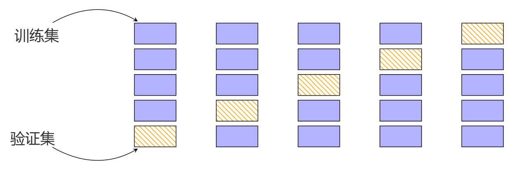

# 8.2 经验风险最小化（Empirical Risk Minimization）

## 本节导学

**学习目标**

1. 理解 ERM 的四个设计选择：假设类、损失函数、正则化、交叉验证；
2. 掌握经验风险 (8.6) 与期望风险 (8.10) 的区别——ERM 用前者近似后者；
3. 会写出最小二乘的矩阵形式 (8.9)，理解它是"线性预测器 + 平方损失"的产物；
4. 理解过拟合的机制与正则化（例 8.3）；
5. 掌握 $K$ 折交叉验证的流程与近似式 (8.13)。

**预备知识**：8.1 节（数据记号）、6.4.1 节（期望与经验均值）、7.1 节（优化）。

**符号速查表**：

| 符号 | 含义 |
| --- | --- |
| $f(\cdot, \boldsymbol\theta)$ | 由 $\boldsymbol\theta$ 参数化的预测器 |
| $\hat y_n = f(\boldsymbol x_n, \boldsymbol\theta)$ | 第 $n$ 个样本的预测 |
| $\ell(y_n, \hat y_n)$ | 损失函数（非负，衡量单次预测误差） |
| $R_{\text{emp}}$ | 经验风险：训练集上的平均损失 (8.6) |
| $R_{\text{true}}$ | 期望风险：所有可能数据上的期望损失 (8.10) |
| $\lambda$ | 正则化参数 |
| 训练集 / 测试集 / 验证集 | train / test / validation split |

---

## 8.2.1 假设函数类

给定 $N$ 个样本-标签对，希望找到参数 $\boldsymbol\theta^*$ 使得

$$
f(\boldsymbol x_n, \boldsymbol\theta^*) \approx y_n \quad \text{对所有 } n \tag{8.3}
$$

**第一个设计选择：允许预测器采用的函数集合是什么？**

> **例 8.1（线性预测器与增广记号）**。回归的流行选择是仿射函数集（机器学习惯例称"线性函数"）。技巧：拼接单位特征 $x_n^{(0)} = 1$，把 $\boldsymbol x_n$ 增广为 $D+1$ 维，则仿射模型写成纯线性形式：

$$
f(\boldsymbol x_n, \boldsymbol\theta) = \boldsymbol\theta^\top \boldsymbol x_n = \theta_0 + \sum_{d=1}^D \theta_d x_n^{(d)} \tag{8.4, 8.5}
$$

——偏置 $\theta_0$ 被吸收进参数向量，后续推导不用单独处理它。（也可用神经网络等更复杂的非线性函数类。）

**第二个设计选择：如何度量拟合优劣？**

## 8.2.2 损失函数与经验风险

**损失函数** $\ell(y_n, \hat y_n)$：输入真实标签与预测值，输出非负实数（损失/误差）。目标是**最小化训练集上的平均损失**。

**i.i.d. 假设的作用**：样本独立同分布保证经验均值是总体均值的优良估计（6.4.1 节），所以"训练集平均损失"有意义。

**经验风险（empirical risk）**：

$$
R_{\text{emp}}(f, \boldsymbol X, \boldsymbol y) = \frac{1}{N} \sum_{n=1}^N \ell(y_n, \hat y_n), \qquad \hat y_n = f(\boldsymbol x_n, \boldsymbol\theta) \tag{8.6}
$$

——**经验风险最小化（ERM）**：用训练数据的平均损失选参数。

> **例 8.2（平方损失 → 最小二乘，完整推导链）**。取 $\ell(y_n, \hat y_n) = (y_n - \hat y_n)^2$，ERM 给出：

$$
\min_{\boldsymbol\theta} \frac{1}{N}\sum_{n=1}^N \big(y_n - f(\boldsymbol x_n, \boldsymbol\theta)\big)^2 \ \xrightarrow{f = \boldsymbol\theta^\top\boldsymbol x_n}\ \min_{\boldsymbol\theta} \frac{1}{N}\sum_{n=1}^N \big(y_n - \boldsymbol\theta^\top \boldsymbol x_n\big)^2 \ =\ \min_{\boldsymbol\theta} \frac{1}{N}\|\boldsymbol y - \boldsymbol X\boldsymbol\theta\|^2 \tag{8.7–8.9}
$$

最后一步：$y_n - \boldsymbol\theta^\top\boldsymbol x_n$ 恰是向量 $\boldsymbol y - \boldsymbol X\boldsymbol\theta$ 的第 $n$ 个分量，平方和 = 范数平方。**最小二乘问题**有闭式解（正规方程，9.2 节详谈）。

**真正的目标：期望风险**。我们想要的不是训练误差小，而是**期望风险**小：

$$
R_{\text{true}}(f) = \mathbb E_{\boldsymbol x, y}[\ell(y, f(\boldsymbol x))] \tag{8.10}
$$

——若有无限数据，这就是要最小化的量。两个问题随之而来：(1) 如何调整训练以**泛化**？(2) 如何用有限数据**估计**期望风险？(8.2.3、8.2.4 节分别回答。)

> **备注**：实际任务常有专门性能指标（准确率、RMSE 等），原则上损失函数应与之对应；实践中常因实现或优化效率而"错位"。♦

## 8.2.3 降低过拟合的正则化

**过拟合（overfitting）**：预测器与训练数据拟合过紧、无法泛化。判据：**训练风险远低于测试风险**。极端情形：足够丰富的函数类可以完全"记住"训练数据（零经验风险），但泛化灾难。

**正则化（regularization）**：给目标函数加惩罚项，使优化器**更难返回过于灵活的预测器**——在"拟合数据"与"解的规模/复杂度"之间折中。

> **例 8.3（正则化最小二乘 = 岭回归）**。在 (8.9) 上加 $\ell_2$ 惩罚：

$$
\min_{\boldsymbol\theta} \frac{1}{N}\|\boldsymbol y - \boldsymbol X\boldsymbol\theta\|^2 + \lambda \|\boldsymbol\theta\|^2 \tag{8.11, 8.12}
$$

$\|\boldsymbol\theta\|^2$ 是**正则化子**，$\lambda$ 是**正则化参数**（权衡"拟合损失"与"参数幅值"）。经验观察：过拟合时参数值往往变得相当大（Bishop, 2006）——惩罚项把 $\boldsymbol\theta$ 往原点拉。（第 9.3 节将看到：这精确等价于高斯先验下的 MAP 估计；第 12 章还会看到它几何上对应 SVM 的"大间隔"。）

## 8.2.4 评估泛化性能的交叉验证

**问题**：数据有限；"训练集大 + 验证集大"两者不可兼得。验证集太小 → 泛化误差估计方差大（噪声大）。

**$K$ 折交叉验证**（图 8.4）：把数据分成 $K$ 块；每次用 $K-1$ 块训练、剩 1 块验证；遍历全部 $K$ 种划分，把 $K$ 次验证误差**取平均**：

$$
\mathbb E_{\mathcal V}[R(f, \mathcal V)] \approx \frac{1}{K}\sum_{k=1}^K R(f^{(k)}, \mathcal V^{(k)}) \tag{8.13}
$$

**两个误差来源**：(1) 训练集有限 → $f^{(k)}$ 不是最佳预测器；(2) 验证集有限 → 对 $R(f^{(k)}, \mathcal V^{(k)})$ 的估计不精确。

**成本与补救**：训练 $K$ 次很贵；但交叉验证是**高度易并行**（embarrassingly parallel）的——云计算下时间不比单次评估长。**超参数搜索**（多个 $\lambda$、模型结构……）可用**嵌套交叉验证**（8.6.1 节）。

  
  
<b>图 8.4</b> K 折交叉验证（K = 5）：K−1 个数据块训练（蓝色），1 个数据块验证（橙色条纹），对 K 次验证误差取平均。

## 8.2.5 延伸阅读

- ERM 的原始提出（Vapnik, 1998）使用了深奥的理论语言，后续发展形成**统计学习理论**（Vapnik, 1999; Evgeniou et al., 2000; Hastie et al., 2001; von Luxburg and Schölkopf, 2011）；建立在理论之上的现代教材：Shalev-Shwartz and Ben-David (2014)。
- 正则化源于病态逆问题的求解（Neumaier, 1998）；本节的方法叫**吉洪诺夫正则化**，约束版叫伊万诺夫正则化；与偏差-方差权衡和特征选择有深刻联系（Bühlmann and Van De Geer, 2011）。
- 交叉验证的替代：自举法（bootstrap）与刀切法（jackknife）（Efron and Tibshirani, 1993）。
- **ERM 并非"完全脱离概率"**：背后仍存在未知的联合分布 $p(\boldsymbol x, y)$，只是 ERM 对该分布**不可知（agnostic）**；标签也无需显式噪声分布——这与经典统计学形成对比。

---

## 本节小结

| 设计选择 | 内容 |
| --- | --- |
| 假设类 | 线性/仿射函数（例 8.1），或更复杂的函数类 |
| 损失 | 平方损失 → 最小二乘 (8.9) |
| 泛化 | 经验风险 ≠ 期望风险；过拟合 = 训练好测试差 |
| 正则化 | $\lambda\|\boldsymbol\theta\|^2$ 抑制参数幅值（例 8.3） |
| 评估 | $K$ 折交叉验证平均验证误差 (8.13) |

**与其他章节的关系**：8.3 节展示"平方损失 + $\ell_2$ 正则"的概率化身（高斯似然 + 高斯先验的 MAP）；9.2 节解出最小二乘闭式解；9.3 节给出正则化的贝叶斯解释；第 12 章 SVM 是 ERM 思想的另一化身（合页损失 + 大间隔）。
