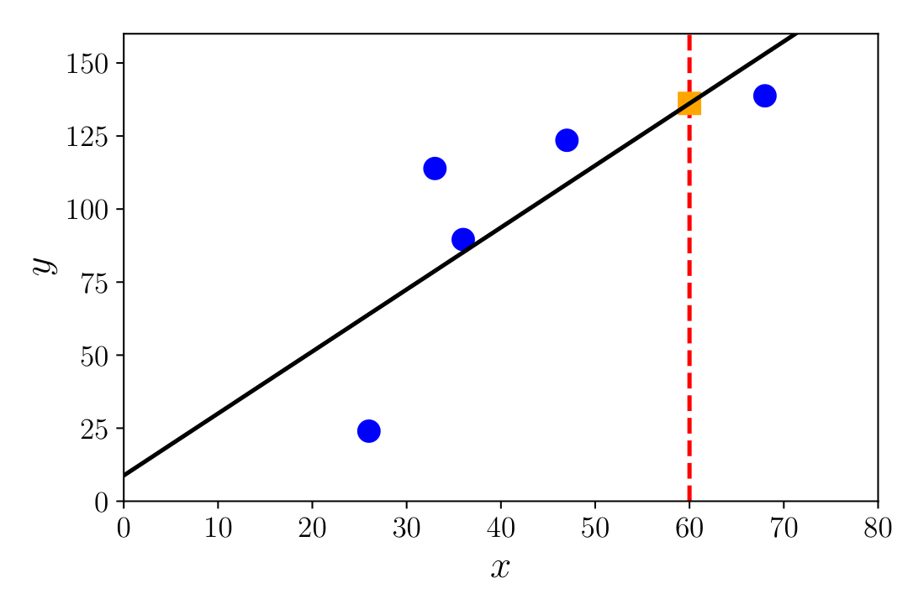
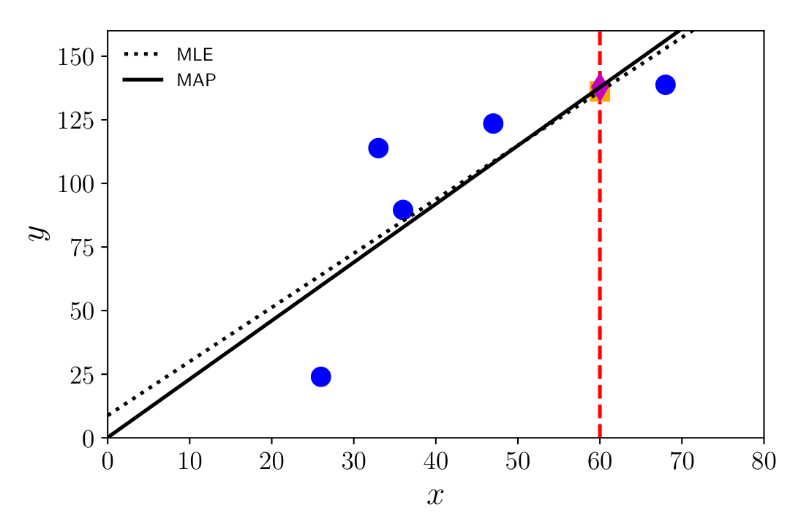
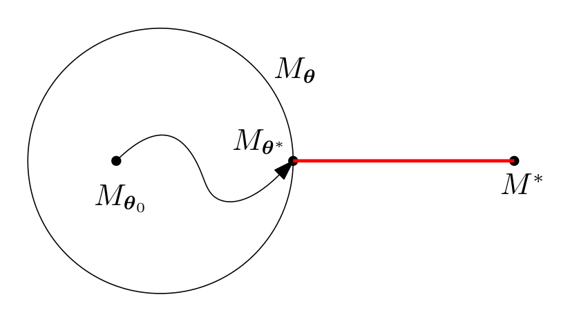
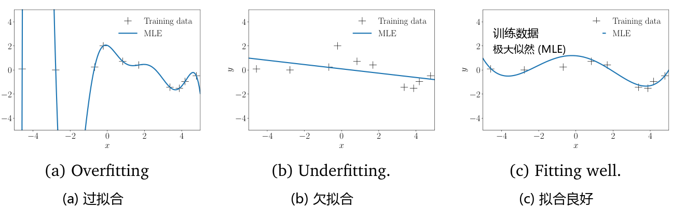

# 8.3 参数估计（Parameter Estimation）

## 本节导学

**学习目标**

1. 理解极大似然估计（MLE）的双重视角：固定参数时似然是数据的分布；固定数据时似然是参数的"可能度"函数；
2. 掌握负对数似然 (8.17) 与 i.i.d. 假设的角色（乘积 ⟹ 求和）；
3. 会推导高斯似然的负对数似然（例 8.5），看清"MLE ⟺ 最小二乘"的精确对应；
4. 掌握最大后验估计（MAP）与正则化的等价关系；
5. 理解过拟合/欠拟合/拟合良好的模型类视角（图 8.7、8.8）。

**预备知识**：6.3 节（贝叶斯定理）、6.5 节（高斯）、6.6.1 节（共轭先验）、8.2 节（ERM）。

**符号速查表**：

| 符号 | 含义 |
| --- | --- |
| $L_{\boldsymbol x}(\boldsymbol\theta) = -\log p(\boldsymbol x \mid \boldsymbol\theta)$ | 负对数似然（NLL） |
| $\mathcal X = \{\boldsymbol x_1, \ldots, \boldsymbol x_N\}$、$\mathcal Y = \{y_1, \ldots, y_N\}$ | 数据集 |
| $\sigma^2$ | 高斯噪声方差（观测不确定性） |
| $p(\boldsymbol\theta)$ | 参数先验 |
| $\mathcal M_{\boldsymbol\theta}$ | 参数化定义的模型类 |

---

## 8.3.1 极大似然估计（MLE）

**核心思想**：定义一个关于参数的函数，找到最能拟合数据的参数。

**负对数似然（negative log-likelihood）**：

$$
L_{\boldsymbol x}(\boldsymbol\theta) = -\log p(\boldsymbol x \mid \boldsymbol\theta) \tag{8.14}
$$

记号强调：$\boldsymbol\theta$ 是变量，$\boldsymbol x$ 固定。

**似然的两种解读**：
1. 固定 $\boldsymbol\theta$：$p(\boldsymbol x \mid \boldsymbol\theta)$ 是对**数据不确定性**建模的分布——"选定模型后，观测到这批数据的概率"；
2. 固定数据：改变 $\boldsymbol\theta$，$L(\boldsymbol\theta)$ 告诉我们这组观测"在多大程度上支持"该参数设置。MLE 取支持度最大的参数。

**监督学习设定**：想要 $p(y_n \mid \boldsymbol x_n, \boldsymbol\theta)$——给定样本时标签的条件分布。

> **例 8.4（高斯似然）**。观测不确定性用零均值独立高斯噪声 $\varepsilon_n \sim \mathcal N(0, \sigma^2)$ 建模，预测用线性模型：

$$
p(y_n \mid \boldsymbol x_n, \boldsymbol\theta) = \mathcal N(y_n \mid \boldsymbol x_n^\top \boldsymbol\theta, \sigma^2) \tag{8.15}
$$

（图 8.3 即此似然的示意：每个输入处一条预测线 + 一个高斯"误差管"。）

**i.i.d. 假设与对数 trick**：独立性让数据集似然**分解为乘积**（6.4.5 节），同分布让所有因子共享参数：

$$
p(\mathcal Y \mid \mathcal X, \boldsymbol\theta) = \prod_{n=1}^N p(y_n \mid \boldsymbol x_n, \boldsymbol\theta) \tag{8.16}
$$

对数把乘积变求和（$\log(ab) = \log a + \log b$）——优化"和"比优化"积"容易得多：

$$
L(\boldsymbol\theta) = -\log p(\mathcal Y \mid \mathcal X, \boldsymbol\theta) = -\sum_{n=1}^N \log p(y_n \mid \boldsymbol x_n, \boldsymbol\theta) \tag{8.17}
$$

（负号是历史惯例：最大化似然 ⟺ 最小化 NLL。）**注意**：$p(y_n \mid \boldsymbol x_n, \boldsymbol\theta)$ 中 $\boldsymbol\theta$ 虽然在条件竖线右侧，但它**不是已观测的固定量**——NLL 是关于 $\boldsymbol\theta$ 的函数，优化对象是它。

> **例 8.5（高斯 NLL ⟺ 最小二乘，逐步推导）**。把 (8.15) 的密度显式代入 (8.17)：
>
> $$
> L(\boldsymbol\theta) = -\sum_{n=1}^N \log \frac{1}{\sqrt{2\pi\sigma^2}} \exp\left(-\frac{(y_n - \boldsymbol x_n^\top\boldsymbol\theta)^2}{2\sigma^2}\right) \tag{8.18a, b}
> $$
>
> 对数拆两项（$\log(ab) = \log a + \log b$，第二项无 $\boldsymbol\theta$）：
>
> $$
> = \underbrace{\frac{1}{2\sigma^2}\sum_{n=1}^N (y_n - \boldsymbol x_n^\top\boldsymbol\theta)^2}_{\text{最小二乘项}} \ \underbrace{-\ \sum_{n=1}^N \log \frac{1}{\sqrt{2\pi\sigma^2}}}_{\text{与 }\boldsymbol\theta\text{ 无关的常数}} \tag{8.18c, d}
> $$
>
> （用了 $\log \exp(z) = z$。）**$\sigma$ 给定时第二项是常数**——最小化 $L(\boldsymbol\theta)$ 严格等价于最小化平方损失 (8.8)。**结论：高斯噪声假设下的 MLE = 最小二乘。**（图 8.5：MLE 参数诱导的直线穿过数据。）高斯情形有闭式解（第 9 章）；非高斯似然则靠第 7 章的数值优化。

  
  
<b>图 8.5</b> 极大似然估计对应黑色实线；橙色方块为 x = 60 处的 MLE 预测值。

## 8.3.2 最大后验估计（MAP）

MLE 只用数据；若还有参数的先验知识 $p(\boldsymbol\theta)$，用贝叶斯定理 (6.3 节) 融合：

$$
p(\boldsymbol\theta \mid \boldsymbol x) = \frac{p(\boldsymbol x \mid \boldsymbol\theta)\, p(\boldsymbol\theta)}{p(\boldsymbol x)} \tag{8.19}
$$

$p(\boldsymbol x)$ 不依赖 $\boldsymbol\theta$，优化时可忽略：

$$
p(\boldsymbol\theta \mid \boldsymbol x) \propto p(\boldsymbol x \mid \boldsymbol\theta)\, p(\boldsymbol\theta) \tag{8.20}
$$

**MAP 估计** = 最大化后验（最小化负对数后验）的点估计。图 8.6 对比 MLE 与 MAP：零均值高斯先验把斜率拉缓、截距拉向零。

> **例 8.6（高斯先验）**。$p(\boldsymbol\theta) = \mathcal N(\boldsymbol 0, \boldsymbol\Sigma)$。高斯的共轭先验仍是高斯（6.6.1 节）⟹ 后验也是高斯。第 9.3 节详解——届时将看到：**高斯先验 + 高斯似然的 MAP = 岭回归（例 8.3）**。

**MAP 是连接两个世界的桥**：承认先验（概率世界），但最终仍输出点估计（非概率世界）。

> **备注（MLE 的优良性质与陷阱）**（Lehmann and Casella, 1998; Efron and Hastie, 2016）：渐近一致性（无限数据极限下收敛到真值 + 渐近正态误差）；误差方差以 $1/N$ 衰减；但所需样本量可能很大，**小数据下 MLE 可能严重过拟合**。♦

  
  
<b>图 8.6</b> MLE 与 MAP 在 x = 60 处的预测对比：先验将斜率偏置得更平缓、截距更接近零。

## 8.3.3 模型拟合：过拟合、欠拟合与拟合良好

"拟合" = 优化参数使损失（如 NLL）最小。参数化定义**模型类** $\mathcal M_{\boldsymbol\theta}$（例：$y = ax + b$ 的直线族）。设数据来自未知真实模型 $\mathcal M^*$，优化让 $\mathcal M_{\boldsymbol\theta}$ 尽可能接近 $\mathcal M^*$（"接近"由目标函数定义）。图 8.7 展示了 $\mathcal M^*$ 落在模型类之外的常见情形。三种结局（图 8.8）：

1. **过拟合（overfitting）**：模型类太丰富——七阶多项式拟合线性数据。症状：训练风险低、**测试风险高**（交叉验证可检测）；过于灵活的模型会"在噪声里找信号"，远离训练数据的预测灾难。
2. **欠拟合（underfitting）**：模型类太贫乏——直线拟合正弦数据。优化再好也够不到真模型。参数通常很少。
3. **拟合良好**：模型类丰富程度刚好——良好泛化的理想状态。

实践中常定义**海量参数**的丰富模型类（如深度网络），用正则化（8.2.3）或先验（8.3.2）抑制过拟合；模型类的选择方法见 8.6 节。

  
  
<b>图 8.7</b> 模型拟合示意：在参数化模型类 Mθ 中优化 θ，逼近真实（未知）模型 M*。

  
  
<b>图 8.8</b> 不同模型类对回归数据集的拟合（MLE）：(a) 过拟合；(b) 欠拟合；(c) 拟合良好。

## 8.3.4 延伸阅读

- **广义线性模型（GLM）**：$p(y_n \mid \boldsymbol x_n, \boldsymbol\theta) = \phi(\boldsymbol\theta^\top \boldsymbol x_n)$（(8.21)）——线性预测 + 非线性**连接函数** $\phi$，覆盖二分类、计数数据等（McCullagh and Nelder, 1989; Agresti, 2002 第 4 章）；指数族视角见 6.6 节。
- MLE 由 Fisher 在 20 世纪 30 年代提出；贝叶斯 vs 频率学派的长期争论可追溯到概率本身的定义（6.1.1 节）——客观综述见 Efron and Hastie (2016)。
- MLE 不可行时的替代：矩估计、M-估计、估计方程（Casella and Berger, 2002）。

---

## 本节小结

| 方法 | 目标 | 与 ERM 的对应 |
| --- | --- | --- |
| MLE | $\min_{\boldsymbol\theta} -\sum_n \log p(y_n \mid \boldsymbol x_n, \boldsymbol\theta)$ | 高斯似然 ⟺ 平方损失 (8.18) |
| MAP | MLE + 先验惩罚 | 高斯先验 ⟺ $\ell_2$ 正则（岭回归） |
| 贝叶斯推断（8.4） | 保留完整后验分布 | 不做点估计 |

**与其他章节的关系**：第 9 章把本节全部思想用于线性回归（MLE 解析解、MAP = 岭回归、完整贝叶斯后验）；8.3.3 的三态分类是贯穿第 9–12 章的诊断语言。
