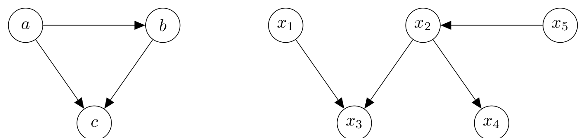
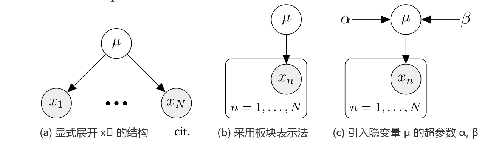
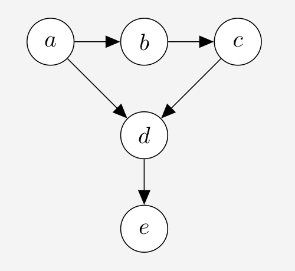
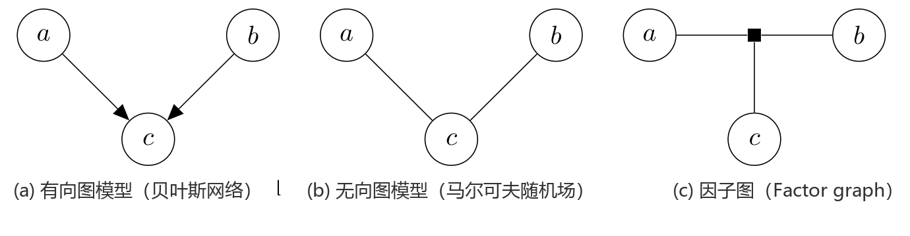

# 8.5 有向图模型（Directed Graphical Models）

## 本节导学

**学习目标**

1. 理解图模型的动机：联合分布可能极其复杂，图让**分解结构**与**条件独立性**一目了然；
2. 掌握两个方向的转换：联合分布因式分解 ⟺ 有向图（例 8.7、8.8）；
3. 记住联合分布的图公式 $p(\boldsymbol x) = \prod_k p(x_k \mid \text{Pa}_k)$（(8.31)）与板块表示法；
4. 会用 **d-分离** 从图拓扑判断条件独立性（例 8.9 的四个判断）。

**预备知识**：6.3 节（乘法法则）、6.4.5 节（条件独立性）、8.4 节（概率模型）。

**符号速查表**：

| 符号 | 含义 |
| --- | --- |
| 节点 | 随机变量（阴影 = 已观测） |
| 有向边 $a \to b$ | 条件概率 $p(b \mid a)$ 的依赖 |
| $\text{Pa}_k$ | $x_k$ 的父节点集合（有箭头直接指向 $x_k$ 的节点） |
| 板块（plate） | 矩形框：内部结构重复 $N$ 次 |
| $A \perp\!\!\!\perp B \mid C$ | 给定 $C$ 时 $A$ 与 $B$ 条件独立 |
| d-分离 | 图拓扑蕴含条件独立的判据 |

---

## 8.5.0 为什么需要图语言

8.4 节确立联合分布是概率模型的核心——但联合分布本身可能极其复杂，而且**不直接揭示结构**。$p(a, b, c)$ 这个表达式不会告诉你任何独立性关系。有向图模型（**贝叶斯网络**）用图直观捕捉：**联合分布如何分解为局部因子的乘积**。

**四大便利**：

1. 直观可视化模型结构；
2. 用于设计或启发新型统计模型；
3. **只看图的拓扑**就能洞察条件独立性；
4. 推断和学习的复杂计算可用图上的**局部操作（消息传递）**表达。

（备注：并非任何分布都能被特定图精确表示——深入讨论见 Bishop 2006。）

## 8.5.1 图语义

**两要素**：节点 = 随机变量（图 8.9(a) 的 $a, b, c$）；有向边 = 条件概率依赖（$a \to b$ 表示 $p(b \mid a)$）。在附加假设下箭头还可表示因果关系（Pearl, 2009）。模块化描述带来计算的大幅简化。

**方向一：从因式分解到图**（例 8.7）。

$$
p(a, b, c) = p(c \mid a, b)\, p(b \mid a)\, p(a) \tag{8.29}
$$

逐因子读依赖关系：$c$ 直接依赖 $a, b$；$b$ 直接依赖 $a$；$a$ 不依赖任何变量——画出图 8.9(a)。

**一般构建流程**：① 为每个随机变量建节点；② 对每个条件分布，从其条件变量（父节点）向该变量画有向边。布局取决于因式分解方式。

**方向二：从图到因式分解**（例 8.8，图 8.9(b)）。两条基本性质：联合分布 = 每个节点条件分布的乘积；每个条件分布只依赖该节点的**父节点**：

$$
p(x_1, x_2, x_3, x_4, x_5) = p(x_1)\, p(x_5)\, p(x_2 \mid x_5)\, p(x_3 \mid x_1, x_2)\, p(x_4 \mid x_2) \tag{8.30}
$$

一般公式（$\text{Pa}_k$ = $x_k$ 的父节点集合）：

$$
p(\boldsymbol x) = \prod_{k=1}^K p(x_k \mid \text{Pa}_k) \tag{8.31}
$$

——**图与因式分解一一对应**，联合分布被"拆解"为每个节点只依赖其父节点的局部条件概率。

  
  
<b>图 8.9</b> 有向图模型示例：(a) 完全连接；(b) 非完全连接。

**应用：重复伯努利实验**。结果 $p(x \mid \mu) = \text{Ber}(\mu)$（(8.32)），重复 $N$ 次：

$$
p(x_1, \ldots, x_N \mid \mu) = \prod_{n=1}^N p(x_n \mid \mu) \tag{8.33}
$$

（独立性 ⟹ 因式分解，6.4.5 节。）**图 8.10(a)**：$N$ 个观测节点（阴影 = 已观测）共享父节点 $\mu$；**(b) 板块表示法**：矩形框把内部结构（$x_n$）重复 $N$ 次——两图等价，板块版紧凑得多；**(c) 超先验**：$\mu$ 上再加 $\text{Beta}(\alpha, \beta)$ 先验——**先验之上的先验**；$\alpha, \beta$ 视为确定性参数时省略其外侧圆圈。

  
  
<b>图 8.10</b> 重复伯努利实验的图模型：(a) 显式展开；(b) 板块表示法；(c) 隐变量 μ 上的 Beta 超先验。

## 8.5.2 条件独立性与 d-分离

**d-分离（d-separation）**（Pearl, 1988）：**只看图拓扑**判断条件独立性的工具。问题设定：不相交节点子集 $A, B, C$，判断图是否蕴含

$$
A \perp\!\!\!\perp B \mid C \tag{8.34}
$$

**判据**：考虑 $A$ 中任意节点到 $B$ 中任意节点的所有**无向轨迹**（忽略箭头方向）。一条路径被**阻断**，如果它含有满足以下任一条件的节点：

1. 箭头在该节点呈**头对尾（head-to-tail）**或**尾对尾（tail-to-tail）**，且该节点 **∈ $C$**（条件化切断了信息流）；
2. 箭头在该节点呈**头对头（head-to-head）**，且该节点及其**所有后代**都 **∉ $C$**（未条件化的碰撞节点天然阻断；条件化碰撞节点反而"打开"通路）。

**所有**路径都被阻断 ⟹ $A$ 与 $B$ 在给定 $C$ 下 **d-分离** ⟹ 联合分布严格满足 $A \perp\!\!\!\perp B \mid C$。

> **例 8.9（d-分离实战，图 8.11）**。对图 8.11 逐项验证（建议对照图自己走一遍路径）：
>
> $$
> b \perp\!\!\!\perp d \mid a, c \quad (8.35) \qquad a \perp\!\!\!\perp c \mid b \quad (8.36)
> $$
> $$
> b \not\perp\!\!\!\perp d \mid c \quad (8.37) \qquad a \not\perp\!\!\!\perp c \mid b, e \quad (8.38)
> $$
>
> **解读要点**：(8.36) 是典型的"中介结构"——$b$ 阻断了 $a \to c$ 的信息流；(8.38) 说明条件化**后代** $e$（碰撞节点的后代）等效于条件化碰撞节点本身，会"打通"本已阻断的路径——这是 d-分离最容易出错的地方。

  
  
<b>图 8.11</b> d-分离示例图模型。

**总结**：有向图模型 + 条件独立性，让我们把联合分布因式分解为**易于优化的局部表达式**（第 10、11 章的利器），并直观看到结构设计选择的影响——这些设计选择（超参数）如何选取，正是 8.6 节的主题。

## 8.5.3 延伸阅读

- 入门：Bishop (2006) 第 8 章；经典巨著：Koller and Friedman (2009)。
- **图模型三大家族**（图 8.12）：① 有向图（贝叶斯网络）；② 无向图（马尔可夫随机场）；③ 因子图。
- 基于图的推断/学习算法（局部消息传递）的应用：在线排位（Herbrich et al., 2007）、计算机视觉（图像分割、去噪、复原）、编码理论（McEliece et al., 1998）、线性方程组求解（Shental et al., 2008）、信号处理中的迭代状态估计（Bickson et al., 2007; Deisenroth and Mohamed, 2012）。
- 本书未深入但重要的主题：**结构化预测**（Bakir et al., 2007; Nowozin et al., 2014）；因果推断的复兴（Pearl, 2009; Imbens and Rubin, 2015; Peters et al., 2017; Rosenbaum, 2017）。

  
  
<b>图 8.12</b> 三种类型的图模型：(a) 有向图模型；(b) 无向图模型（马尔可夫随机场）；(c) 因子图。

---

## 本节小结

| 要点 | 内容 |
| --- | --- |
| 图语义 | 节点 = 随机变量；边 = 条件依赖；联合 = $\prod_k p(x_k \mid \text{Pa}_k)$ |
| 板块表示法 | 紧凑表达重复结构（i.i.d. 观测） |
| d-分离 | 头对尾/尾对尾：条件化阻断；头对头：条件化（或其后代）反而打通 |
| 价值 | 结构可视化 + 条件独立一目了然 + 局部消息传递算法 |

**与其他章节的关系**：第 9–11 章的每个概率模型都会配图；d-分离是理解 EM 算法（第 11 章）和概率 PCA（10.7 节）结构的基础；因果推断（Pearl, 2009）是图模型最富雄心的应用方向。
