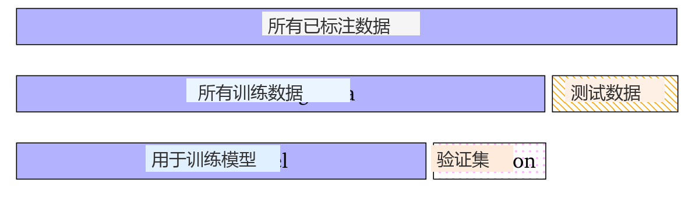
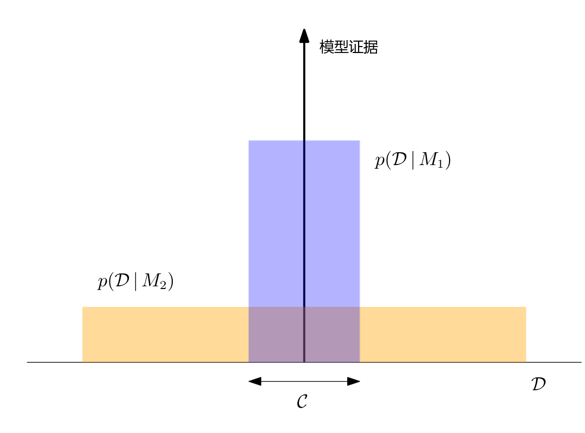
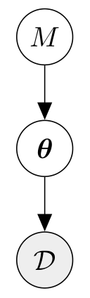

# 8.6 模型选择（Model Selection）

## 本节导学

**学习目标**

1. 理解模型选择问题的本质：在模型复杂度与数据拟合之间权衡，以泛化性能为准绳；
2. 掌握**嵌套交叉验证**的两层结构（内层选模型/超参数，外层估泛化）；
3. 掌握**贝叶斯模型选择**：模型证据 (8.44)、"自动奥卡姆剃刀"的几何直觉（图 8.14）；
4. 会解释**贝叶斯因子** (8.46) 与杰弗里斯-林德利悖论；
5. 知道 AIC/BIC 两个信息准则的形式与差别。

**预备知识**：8.2.4 节（交叉验证）、8.3 节（过拟合）、8.4 节（边缘似然）、6.6.1 节（共轭模型）。

**符号速查表**：

| 符号 | 含义 |
| --- | --- |
| $\mathcal M = \{\mathcal M_1, \ldots, \mathcal M_K\}$ | 候选模型集合 |
| $\mathcal M^* = \arg\max_{\mathcal M_k} p(\mathcal M_k \mid \mathcal D)$ | 模型上的 MAP (8.45) |
| $p(\mathcal D \mid \mathcal M_k) = \int p(\mathcal D \mid \boldsymbol\theta_k)\, p(\boldsymbol\theta_k \mid \mathcal M_k)\,\mathrm d\boldsymbol\theta_k$ | 模型证据 / 边缘似然 (8.44) |
| 后验几率 = 先验几率 × 贝叶斯因子 | (8.46) |
| AIC / BIC | 赤池 / 贝叶斯信息准则 (8.48)(8.49) |
| $M$ / $N$ | 参数个数 / 数据点数 |

---

## 8.6.0 问题设定

**模型选择的对象**：影响性能的高层决策——多项式阶数、混合模型成分数、网络架构、核函数类型、潜空间维度、学习率……它们决定模型类的灵活性与表达能力（例：二次多项式通过令 $a_2 = 0$ 严格包含一次多项式）。

**核心矛盾**：灵活 ≠ 更好。训练阶段只能用训练集评估与学习参数，而 MLE 在小数据下严重过拟合（8.3 节）。我们需要机制评估**泛化到未见测试数据**的能力——这就是模型选择。

## 8.6.1 嵌套交叉验证

**两层结构**（图 8.13）：

- **内层循环**：对每个候选模型/超参数，做 $K$ 折交叉验证，用验证集经验误差近似期望泛化误差：

$$
\mathbb E_{\mathcal V}[R(\mathcal V \mid \mathcal M)] \approx \frac{1}{K}\sum_{k=1}^K R(\mathcal V^{(k)} \mid \mathcal M) \tag{8.39}
$$

选出内层最优模型。（还能得到**标准误差** $\sigma/\sqrt{K}$——均值估计的不确定性。）

- **外层循环**：在**保留的测试集**上评估内层选出的最终模型——这才是无偏的泛化性能估计。

**术语区分**：用于估计泛化性能的集合 = **测试集**；用于选择最佳模型的集合 = **验证集**。

  
  
<b>图 8.13</b> 嵌套交叉验证示意：两级 K 折交叉验证。

## 8.6.2 贝叶斯模型选择

**奥卡姆剃刀**：寻找"能合理解释数据的最简单模型"。贝叶斯框架**不需要手工给简单模型加先验**——"自动奥卡姆剃刀"（automatic Occam's razor）在数量上自然涌现（Smith and Spiegelhalter, 1980; Jefferys and Berger, 1992; MacKay, 1992）。

**直觉（图 8.14，改编自 MacKay 2003）**：横轴 = 所有可能数据集 $\mathcal D$ 的空间，纵轴 = 模型证据。

- 简单模型 $\mathcal M_1$：只能预测一小部分数据集——但在它能预测的区域 $C$ 内，预测**集中**（概率质量大）；
- 强大模型 $\mathcal M_2$：能预测种类更多的数据集——但证据分布必须**摊开**（对所有 $\mathcal D$ 积分 = 1），所以在区域 $C$ 内反而不如 $\mathcal M_1$ 集中。

**若数据落在 $C$：简单模型 $\mathcal M_1$ 的后验更高**——不是因为我们偏爱简单，而是概率归一化的数学必然。

  
  
<b>图 8.14</b> 贝叶斯推断体现奥卡姆剃刀：模型证据 p(D|Mᵢ) 评估模型预测数据的能力；p(D|Mᵢ) 对所有可能数据集积分必须为 1，所以强大模型的证据必然更分散。（改编自 MacKay, 2003）

**形式化**。模型集合 $\mathcal M = \{\mathcal M_1, \ldots, \mathcal M_K\}$，模型 $\mathcal M_k$ 有参数 $\boldsymbol\theta_k$。模型上引入先验 $p(\mathcal M)$，**层级生成过程**（图 8.15）：

$$
\mathcal M_k \sim p(\mathcal M) \quad (8.40), \qquad \boldsymbol\theta_k \sim p(\boldsymbol\theta \mid \mathcal M_k) \quad (8.41), \qquad \mathcal D \sim p(\mathcal D \mid \boldsymbol\theta_k) \quad (8.42)
$$

**贝叶斯定理用于模型**：

$$
p(\mathcal M_k \mid \mathcal D) \propto p(\mathcal M_k)\, p(\mathcal D \mid \mathcal M_k) \tag{8.43}
$$

参数已被积分消除：

$$
p(\mathcal D \mid \mathcal M_k) = \int p(\mathcal D \mid \boldsymbol\theta_k)\, p(\boldsymbol\theta_k \mid \mathcal M_k)\,\mathrm d\boldsymbol\theta_k \tag{8.44}
$$

——**模型证据 / 边缘似然**。模型上的 MAP（(8.45)）：均匀先验 $p(\mathcal M_k) = 1/K$ 下，等价于**选模型证据最大的模型**。

> **备注（似然 vs 边缘似然）**：似然容易过拟合（要拟合参数）；边缘似然**不会**——参数已被积分消除（"不需要拟合"）；它**自动**体现复杂度与拟合的权衡。♦

  
  
<b>图 8.15</b> 贝叶斯模型选择的层级生成过程：模型先验 → 参数分布 → 数据。

## 8.6.3 用于模型比较的贝叶斯因子

比较两个模型的后验概率之比，展开贝叶斯定理、约去公共的 $p(\mathcal D)$：

$$
\underbrace{\frac{p(\mathcal M_1 \mid \mathcal D)}{p(\mathcal M_2 \mid \mathcal D)}}_{\text{后验几率}} = \underbrace{\frac{p(\mathcal M_1)}{p(\mathcal M_2)}}_{\text{先验几率}} \cdot \underbrace{\frac{p(\mathcal D \mid \mathcal M_1)}{p(\mathcal D \mid \mathcal M_2)}}_{\text{贝叶斯因子}} \tag{8.46}
$$

- **贝叶斯因子** = 边缘似然之比：度量"与 $\mathcal M_2$ 相比，$\mathcal M_1$ 预测数据的好坏"；
- 均匀模型先验下：后验几率 = 贝叶斯因子 (8.47)；大于 1 选 $\mathcal M_1$（有类似"显著性"的参考指南，Jeffreys, 1961）。

> **备注（杰弗里斯-林德利悖论）**："贝叶斯因子总是偏向简单模型——在**弥散先验**（diffuse prior，不偏向任何特定模型）的复杂模型下，数据的边缘概率非常小"（Murphy, 2012）。这正是图 8.14 的数学表达：先验越弥散，证据被摊得越薄。♦

> **备注（计算边缘似然）**：积分 (8.44) 通常解析不可积——数值积分（Stoer and Burlirsch, 2002）、蒙特卡洛（Murphy, 2012）、贝叶斯蒙特卡洛（O'Hagan, 1991; Rasmussen and Ghahramani, 2003）。**共轭模型可闭式计算**（6.6.1 节）——第 9 章将在贝叶斯线性回归中严格实现。♦

## 8.6.4 延伸阅读

**常见超参数示例**：回归的多项式阶数、混合模型成分数、（深度）网络架构、SVM 核类型、PCA 潜空间维度、优化算法学习率。

**自动奥卡姆剃刀的精确含义**（Rasmussen and Ghahramani, 2001）：惩罚的不是**参数数量**，而是**函数复杂度**——且同样适用于无限参数的贝叶斯非参数模型（如高斯过程）。

**信息准则**（极大似然框架下的过拟合抑制启发式，取最大者）：

1. **AIC**（赤池信息准则，Akaike, 1974）：

$$
\log p(\boldsymbol x \mid \boldsymbol\theta) - M \tag{8.48}
$$

用惩罚项修正 MLE 的偏差；$M$ = 参数个数。

2. **BIC**（贝叶斯信息准则，Schwarz, 1978）：

$$
\log p(\boldsymbol x) = \log \int p(\boldsymbol x \mid \boldsymbol\theta)\, p(\boldsymbol\theta)\,\mathrm d\boldsymbol\theta \approx \log p(\boldsymbol x \mid \boldsymbol\theta) - \frac{1}{2}M\log N \tag{8.49}
$$

可视为边缘似然的渐近近似（指数族）；惩罚比 AIC **严厉得多**（$M\log N$ vs $M$）。

---

## 本节小结

| 方法 | 核心量 | 一句话 |
| --- | --- | --- |
| 嵌套交叉验证 | 内层验证误差 (8.39) | 内层选超参数，外层估泛化 |
| 贝叶斯模型选择 | 模型证据 (8.44) | 边缘似然自动实现奥卡姆剃刀 |
| 贝叶斯因子 | 证据之比 (8.46) | 均匀先验下 = 后验几率 |
| AIC / BIC | $\log p(\boldsymbol x \mid \boldsymbol\theta) - M$ / $-\frac12 M\log N$ | MLE 的复杂度惩罚近似 |

**与其他章节的关系**：第 9.3 节贝叶斯线性回归将闭式计算模型证据；第 10 章 PCA 的潜空间维度、第 11 章 GMM 的成分数、第 12 章 SVM 的正则化参数——四大支柱的每个超参数都用本章的方法选取。本章也是 Part II 的理论枢纽：8.2/8.3/8.4 的三种学习风格将在第 9–12 章全面展开。
