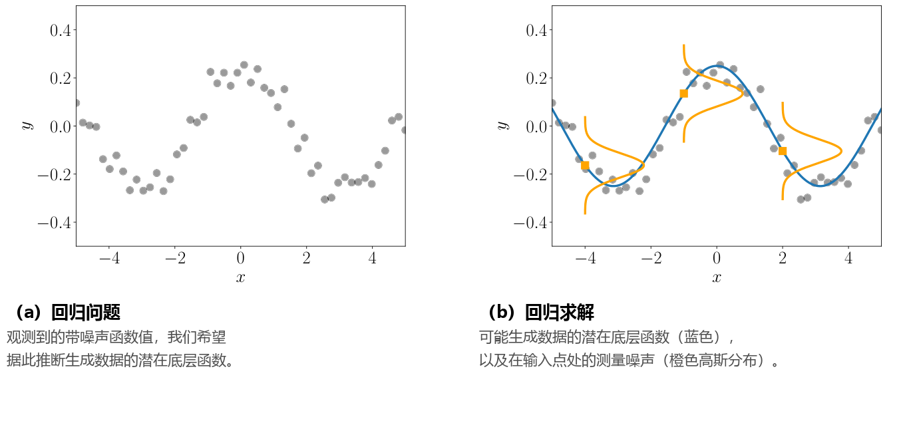

# 第 9 章 线性回归（Linear Regression）

## 本章导学

**学习目标**：综合运用第 2、5、6、7 章的工具解决**曲线拟合**问题——找函数 $f : \mathbb R^D \to \mathbb R$，使它对带噪声观测 $y_n = f(\boldsymbol x_n) + \epsilon$ 既拟合良好又泛化优秀。本章是 Part I 数学的"大阅兵"，也是四大支柱的第一根。

**本章要解决的五个问题**：

1. **模型选择与参数化**：用哪个函数类（多项式阶数等）？（8.6 节的模型选择；噪声固定为高斯。）
2. **寻找优良参数**：什么目标函数定义"拟合好"？怎么优化？（9.2 节：MLE / MAP，闭式解！）
3. **过拟合**：拟合太好却泛化差怎么办？（9.2.2 节的现象分析 + MAP 正则化缓解。）
4. **损失与先验的联系**：平方损失、$\ell_2$ 正则各自对应什么概率假设？（9.2.4 节精确对应。）
5. **不确定性建模**：有限数据下，预测的置信区间在哪？（9.3 节贝叶斯线性回归。）

**路线**：9.1 形式化 → 9.2 MLE 与 MAP（点估计）→ 9.3 贝叶斯线性回归（分布估计）→ 9.4 几何视角（MLE = 正交投影）→ 9.5 延伸阅读。

**预备知识**：3.1 节（范数与平方距离）、5.2 节（行向量梯度）、5.5 节（二次型求导公式 (5.107)(5.108)）、6.5 节（高斯分布）、7.3 节（凸优化）、8.2–8.4 节（三种学习风格）。

**符号速查表**（全章通用）：

| 符号 | 含义 |
| --- | --- |
| $\boldsymbol x_n \in \mathbb R^D$、$y_n \in \mathbb R$ | 第 $n$ 个训练输入 / 带噪声观测 |
| $\boldsymbol\theta \in \mathbb R^D$（或 $\mathbb R^K$） | 模型参数 |
| $\boldsymbol X \in \mathbb R^{N \times D}$ | 设计矩阵：第 $n$ 行 = $\boldsymbol x_n^\top$ |
| $\boldsymbol\Phi \in \mathbb R^{N \times K}$ | 特征矩阵：$\Phi_{ij} = \phi_j(\boldsymbol x_i)$ |
| $\boldsymbol\phi : \mathbb R^D \to \mathbb R^K$ | 特征映射（多项式基、径向基……） |
| $\sigma^2$ | 高斯观测噪声方差（先假设已知，9.2.1 末估计它） |
| $\epsilon \sim \mathcal N(0, \sigma^2)$ | i.i.d. 测量噪声 |

  
  
<b>图 9.1</b> (a) 数据集（带噪声观测 yₙ = f(xₙ) + ε）；(b) 回归问题的一个可能解（以 f(x) 为中心的三个分布代表测量噪声）。

**回归的应用面**：时间序列分析（系统辨识）、控制与机器人（强化学习、正向/逆向模型）、连续优化（线搜索）、深度学习（语音、图像、视频标注），也是许多分类算法的关键组件。
