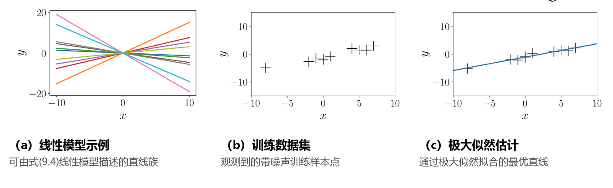

# 9.1 问题表述（Problem Formulation）

## 本节导学

**学习目标**

1. 写出线性回归的似然 (9.3) 并理解其两个等价视角（条件分布 / 加性噪声方程）；
2. 弄清"线性回归"的准确含义——**对参数线性**，而非对输入线性；
3. 理解狄拉克 $\delta$ 函数在 $\sigma^2 \to 0$ 极限下的角色（无噪声 = 确定性关系）。

**预备知识**：6.5 节（高斯分布）、8.1.3 节（概率模型视角）。

---

## 9.1.1 似然的构造

观测有噪声，所以用概率方法并对噪声**显式建模**。全章的似然：

$$
p(y \mid \boldsymbol x) = \mathcal N\big(y \mid f(\boldsymbol x), \sigma^2\big) \tag{9.1}
$$

等价地写成"函数 + 噪声"的形式：

$$
y = f(\boldsymbol x) + \epsilon, \qquad \epsilon \sim \mathcal N(0, \sigma^2) \tag{9.2}
$$

目标：找到与生成数据的未知函数 $f$ 接近、且泛化良好的函数。

**参数化模型**：选一个参数化函数，找"良好运作"的参数 $\boldsymbol\theta$。**线性回归** = 参数在模型中线性出现的特殊情况：

$$
p(y \mid \boldsymbol x, \boldsymbol\theta) = \mathcal N\big(y \mid \boldsymbol x^\top \boldsymbol\theta, \sigma^2\big) \iff y = \boldsymbol x^\top \boldsymbol\theta + \epsilon \tag{9.3, 9.4}
$$

（目前假设 $\sigma^2$ 已知，专注学习 $\boldsymbol\theta$。）式 (9.4) 是过原点的直线族。

**似然的语义**：$p(y \mid \boldsymbol x, \boldsymbol\theta)$ 是在 $\boldsymbol x^\top\boldsymbol\theta$ 处评估的 $y$ 的密度。**唯一的不确定性来源是观测噪声**（$\boldsymbol x, \boldsymbol\theta$ 都视为已知）。若无噪声，$y$ 与 $\boldsymbol x$ 的关系是确定性的，似然退化为**狄拉克 $\delta$ 函数**——除单点外处处为零、全域积分为 1，可视为高斯分布在 $\sigma^2 \to 0$ 时的极限。

> **例 9.1**。$x, \theta \in \mathbb R$ 时，(9.4) 是过原点的直线，$\theta$ 是斜率。图 9.2(a) 画了不同 $\theta$ 的函数示例；(b) 是训练集；(c) 是极大似然拟合（9.2 节求解）。

  
  
<b>图 9.2</b> 线性回归示例：(a) 函数类示例；(b) 训练集；(c) 极大似然估计。

## 9.1.2 "线性"的正确理解

> **"线性回归"指的是在参数上呈线性的模型。**

式 (9.3)–(9.4) 对参数和输入都线性，但这只是特例。对输入做**任意非线性变换** $\boldsymbol\phi(\boldsymbol x)$ 后：

$$
y = \boldsymbol\phi^\top(\boldsymbol x)\,\boldsymbol\theta + \epsilon
$$

仍是线性回归——因为参数 $\boldsymbol\theta$ 仍以线性组合的方式出现。这里"特征"指输入的表示 $\boldsymbol\phi(\boldsymbol x)$。9.2.1 节的多项式回归（例 9.3）就是明证：把一维 $x$ 提升到 $K$ 维单项式空间后，$K-1$ 阶多项式 $f(x) = \sum_{k=0}^{K-1}\theta_k x^k = \boldsymbol\phi^\top(x)\boldsymbol\theta$ 完全落在"对参数线性"的框架内。**这条灵活性是线性回归威力的一半**；另一半是 9.4 节的投影几何。

---

## 本节小结

| 要点 | 内容 |
| --- | --- |
| 似然 (9.3) | $y$ 的条件高斯，均值 = 预测，方差 = 观测噪声 |
| 无噪声极限 | $\sigma^2 \to 0$：高斯退化为狄拉克 $\delta$，关系变确定 |
| 线性的含义 | 对**参数**线性；输入可任意非线性变换（特征映射） |

**与其他章节的关系**：9.2 节在此似然上做 MLE/MAP；12.4 节的核方法把"特征映射"推向极致（隐式无限维特征）。
