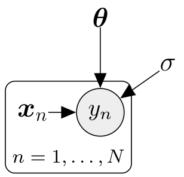
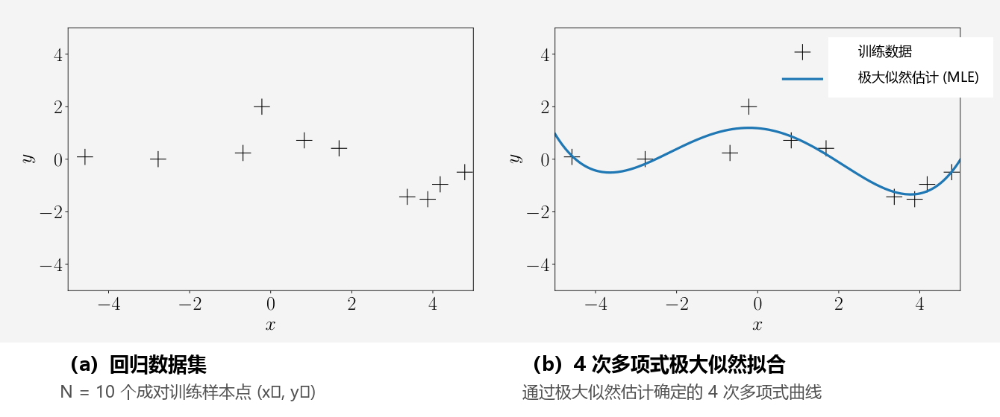
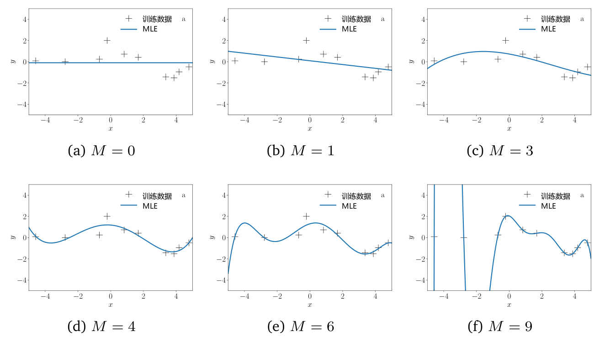
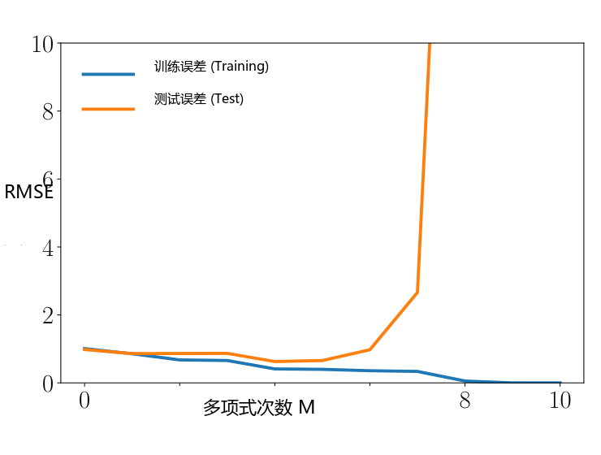
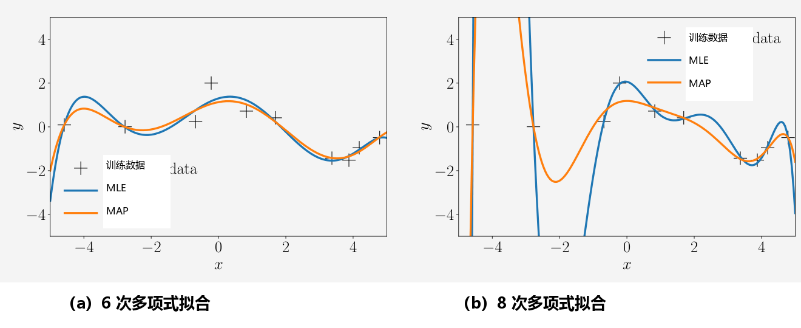

# 9.2 参数估计（Parameter Estimation）

## 本节导学

**学习目标**

1. 从 i.i.d. 似然出发，完整推导 MLE 的闭式解 (9.12c)——梯度展开、令零、解正规方程；
2. 掌握特征映射下的推广（特征矩阵 $\boldsymbol\Phi$，解 (9.19)）与噪声方差的 MLE (9.22)；
3. 理解过拟合在多项式回归中的具体表现（图 9.5、9.6）；
4. 完整推导高斯先验下的 MAP 解 (9.31)，看清它与 MLE 的唯一差别；
5. 证明 **MAP = 正则化最小二乘（岭回归）**（$\lambda = \sigma^2/b^2$）。

**预备知识**：5.5 节二次型求导 (5.107)、8.3 节（MLE/MAP 概念）、3.8 节（伪逆 $（\boldsymbol B^\top\boldsymbol B)^{-1}\boldsymbol B^\top$ 已在 (3.57) 见过）。

---

## 9.2.0 设定与似然

训练集 $\mathcal D = \{(\boldsymbol x_n, y_n)\}_{n=1}^N$，概率图模型见图 9.3（$y_n$ 阴影 = 已观测，$\boldsymbol\theta$ 无圈 = 待估参数）。**条件独立**：给定各自输入与参数，$y_i \perp\!\!\!\perp y_j$，于是似然分解：

$$
p(\mathcal Y \mid \mathcal X, \boldsymbol\theta) = \prod_{n=1}^N p(y_n \mid \boldsymbol x_n, \boldsymbol\theta) = \prod_{n=1}^N \mathcal N(y_n \mid \boldsymbol x_n^\top \boldsymbol\theta, \sigma^2) \tag{9.5}
$$

找到 $\boldsymbol\theta^*$ 后，任意测试点 $\boldsymbol x_*$ 的预测分布：

$$
p(y_* \mid \boldsymbol x_*, \boldsymbol\theta^*) = \mathcal N(y_* \mid \boldsymbol x_*^\top \boldsymbol\theta^*, \sigma^2) \tag{9.6}
$$

  
  
<b>图 9.3</b> 线性回归的概率图模型。

## 9.2.1 极大似然估计

**目标**：$\boldsymbol\theta_{\text{ML}} = \arg\max_{\boldsymbol\theta} p(\mathcal Y \mid \mathcal X, \boldsymbol\theta)$（(9.7)）。

> **备注（似然不是概率分布）**：$p(y \mid \boldsymbol x, \boldsymbol\theta)$ 关于 $\boldsymbol\theta$ 未归一化（甚至不可积）——它只是参数的函数；关于 $y$ 才是归一化的分布。♦

**为什么取对数**：(9.5) 是 $N$ 个高斯的连乘——(a) 数值下溢（$N$ 大时 $10^{-256}$ 级别的数无法精确表示）；(b) 乘积求导要反复用乘积法则 (5.46)。对数把乘积变求和，两个问题一起解决。

**第 1 步：写出负对数似然**。逐点高斯对数密度只保留与 $\boldsymbol\theta$ 有关的部分：

$$
\log p(y_n \mid \boldsymbol x_n, \boldsymbol\theta) = -\frac{1}{2\sigma^2}(y_n - \boldsymbol x_n^\top\boldsymbol\theta)^2 + \text{const} \tag{9.9}
$$

代入 (9.8) 并写成矩阵形式（**设计矩阵** $\boldsymbol X$：第 $n$ 行 = $\boldsymbol x_n^\top$）：

$$
L(\boldsymbol\theta) := \frac{1}{2\sigma^2}\sum_{n=1}^N (y_n - \boldsymbol x_n^\top\boldsymbol\theta)^2 = \frac{1}{2\sigma^2}(\boldsymbol y - \boldsymbol X\boldsymbol\theta)^\top(\boldsymbol y - \boldsymbol X\boldsymbol\theta) = \frac{1}{2\sigma^2}\|\boldsymbol y - \boldsymbol X\boldsymbol\theta\|^2 \tag{9.10}
$$

（残差平方和 = $\boldsymbol y$ 与 $\boldsymbol X\boldsymbol\theta$ 的欧氏平方距离，3.1 节。）$L$ 是 $\boldsymbol\theta$ 的**二次函数** ⟹ 唯一的全局最优解，梯度为零即得。

**第 2 步：算梯度**（逐项用求和法则与二次型求导公式 (5.107)）：

$$
\frac{\mathrm dL}{\mathrm d\boldsymbol\theta} = \frac{1}{2\sigma^2}\frac{\mathrm d}{\mathrm d\boldsymbol\theta}\big[\boldsymbol y^\top\boldsymbol y - 2\boldsymbol y^\top\boldsymbol X\boldsymbol\theta + \boldsymbol\theta^\top\boldsymbol X^\top\boldsymbol X\boldsymbol\theta\big] = \frac{1}{\sigma^2}\big(-\boldsymbol y^\top\boldsymbol X + \boldsymbol\theta^\top\boldsymbol X^\top\boldsymbol X\big) \in \mathbb R^{1 \times D} \tag{9.11}
$$

（三项分别求导：常数项为 0；线性项 $-2\boldsymbol y^\top\boldsymbol X\boldsymbol\theta$ 的梯度是 $-2\boldsymbol y^\top\boldsymbol X$；二次项用 (5.107) 得 $2\boldsymbol\theta^\top\boldsymbol X^\top\boldsymbol X$。）

**第 3 步：令梯度为零、解方程**（**正规方程组** $\boldsymbol A\boldsymbol\theta = \boldsymbol b$，$\boldsymbol A = \boldsymbol X^\top\boldsymbol X$，$\boldsymbol b = \boldsymbol X^\top\boldsymbol y$）：

$$
\boldsymbol\theta_{\text{ML}}^\top \boldsymbol X^\top \boldsymbol X = \boldsymbol y^\top \boldsymbol X \iff \boldsymbol\theta_{\text{ML}} = (\boldsymbol X^\top \boldsymbol X)^{-1}\boldsymbol X^\top \boldsymbol y \tag{9.12}
$$

**可逆条件**：$N \geqslant D$ 且 $\operatorname{rk}(\boldsymbol X) = D$ 时，$\boldsymbol X^\top\boldsymbol X$ 正定，逆存在。

> **备注（充分性）**：令梯度为零此处也是**充分**条件——黑塞 $\nabla^2 L = \frac{1}{\sigma^2}\boldsymbol X^\top\boldsymbol X$ 半正定（满秩时严格正定），驻点必为全局极小（7.3 节凸性）。♦

> **例 9.2（拟合直线）**。图 9.2(b) 的数据集 + 模型 $f(x) = \theta x$：把 (9.12c) 的 $\boldsymbol X$ 换成列向量 $\boldsymbol x$，得标量解 $\theta_{\text{ML}} = \frac{\boldsymbol x^\top\boldsymbol y}{\boldsymbol x^\top\boldsymbol x}$——斜率 = 输入与输出的内积除以输入的平方范数。图 9.2(c) 为拟合结果。

### 特征映射下的 MLE

直线表达能力不足时，用**特征映射** $\boldsymbol\phi : \mathbb R^D \to \mathbb R^K$ 提升输入：

$$
y = \boldsymbol\phi^\top(\boldsymbol x)\,\boldsymbol\theta + \epsilon = \sum_{k=0}^{K-1}\theta_k \phi_k(\boldsymbol x) + \epsilon \tag{9.13}
$$

**参数仍线性出现**——9.1.2 节的核心思想。

> **例 9.3（多项式回归 = 单项式基）**。$\boldsymbol\phi(x) = [1, x, x^2, \ldots, x^{K-1}]^\top$：一维输入提升到 $K$ 维单项式空间，$K-1$ 阶多项式 $f(x) = \sum_k \theta_k x^k = \boldsymbol\phi^\top(x)\boldsymbol\theta$。

**特征矩阵**（设计矩阵的推广，$\Phi_{ij} = \phi_j(\boldsymbol x_i)$）：

$$
\boldsymbol\Phi = \begin{bmatrix} \boldsymbol\phi^\top(\boldsymbol x_1) \\ \vdots \\ \boldsymbol\phi^\top(\boldsymbol x_N) \end{bmatrix} \in \mathbb R^{N \times K} \tag{9.16}
$$

> **例 9.4（二次多项式）**。$\boldsymbol\Phi$ 的第 $n$ 行是 $[1, x_n, x_n^2]$——三列分别是常数、线性、二次特征。

负对数似然与 (9.10b) 完全同构（$\boldsymbol X \to \boldsymbol\Phi$），而 $\boldsymbol\Phi$ 同样与 $\boldsymbol\theta$ 无关，于是**立即得到**：

$$
\boldsymbol\theta_{\text{ML}} = (\boldsymbol\Phi^\top \boldsymbol\Phi)^{-1}\boldsymbol\Phi^\top \boldsymbol y \tag{9.19}
$$

可逆条件：$\operatorname{rk}(\boldsymbol\Phi) = K$（特征间无冗余）。形式与 (3.57) 的伪逆一致——$\boldsymbol\Phi$ 不是方阵也能算。

> **例 9.5（4 次多项式拟合）**。$N = 10$ 个数据点，$y_n = -\sin(x_n/5) + \cos(x_n) + \epsilon$（$\sigma = 0.2$）。用 (9.19) 拟合 4 次多项式，图 9.4(b)——曲线平滑地跟随数据趋势。

  
  
<b>图 9.4</b> 多项式回归：(a) 数据集（N = 10）；(b) MLE 确定的 4 次多项式拟合。

### 估计噪声方差

$\sigma^2$ 也可以一并 MLE。对数似然（保留全部 $\sigma^2$ 依赖项，记 $s := \sum_n (y_n - \boldsymbol\phi^\top(\boldsymbol x_n)\boldsymbol\theta)^2$）：

$$
\log p(\mathcal Y \mid \mathcal X, \boldsymbol\theta, \sigma^2) = -\frac{N}{2}\log\sigma^2 - \frac{1}{2\sigma^2}\,s + \text{const} \tag{9.20}
$$

对 $\sigma^2$ 求偏导、令零（注意链式：$\frac{\partial}{\partial\sigma^2}\log\sigma^2 = \frac{1}{\sigma^2}$，$\frac{\partial}{\partial\sigma^2}\frac{1}{\sigma^2} = -\frac{1}{\sigma^4}$）：

$$
-\frac{N}{2\sigma^2} + \frac{s}{2\sigma^4} = 0 \iff N\sigma^2 = s \iff \boxed{\ \sigma^2_{\text{ML}} = \frac{1}{N}\sum_{n=1}^N (y_n - \boldsymbol\phi^\top(\boldsymbol x_n)\boldsymbol\theta)^2\ } \tag{9.21, 9.22}
$$

——残差平方的**经验均值**。（有偏估计；贝叶斯处理见 Murphy 2012。）

## 9.2.2 线性回归中的过拟合

**评估指标**：实践中常用**均方根误差**（RMSE，(9.23)）——与 $y_n$ 同量纲（平方损失的单位是 $y$ 单位的平方，不好解释）；可在不同规模数据集间公平比较。

**模型选择**：用 RMSE/NLL 对不同多项式阶数 $M$ 做网格搜索。$M$ 只需试到 $N-1$：$M < N$ 时 MLE 唯一；$M \geqslant N$ 时参数多于数据点，$\boldsymbol\Phi^\top\boldsymbol\Phi$ 不可逆，欠定方程有无穷多解。

**实验观察**（图 9.5、9.6，$N = 10$ + 独立的 200 点测试集）：

- $M = 0, 1$：欠拟合，抓不住真实函数；
- $M = 3, 4, 5$：合理平滑地穿过数据趋势；
- $M = 9 = N-1$：**曲线完美穿过每个训练点**，但样本点之间剧烈振荡——严重**过拟合**；
- 误差曲线（图 9.6）：**训练误差随 $M$ 单调非增**；测试误差先降后升，$M = 4$ 处最低。

**规律**：测试误差是"偏差（模型太简单）与方差（模型太灵活）"的权衡——8.6 节的模型选择就是为找这个最低点。

  
  
<b>图 9.5</b> 不同多项式阶数 M 下的 MLE 拟合对比。

  
  
<b>图 9.6</b> 训练误差与测试误差随多项式阶数 M 的变化曲线。

## 9.2.3 最大后验估计

MLE 的过拟合伴随**参数绝对值异常庞大**（Bishop, 2006）。对策：给参数加**先验分布** $p(\boldsymbol\theta)$——显式编码"看到数据前哪些参数取值可信"（例：$\theta \sim \mathcal N(0, 1)$ 表示 95% 置信区间 $[-2, 2]$）。**MAP** = 最大化后验 (9.24) 的点估计。

**第 1 步：对数后验 = 对数似然 + 对数先验 + 常数**（(9.25)）——MAP 本质是"先验常识"与"数据似然"的折中。

**第 2 步：取（共轭）高斯先验** $p(\boldsymbol\theta) = \mathcal N(\boldsymbol 0, b^2\boldsymbol I)$，负对数后验：

$$
-\log p(\boldsymbol\theta \mid \mathcal X, \mathcal Y) = \underbrace{\frac{1}{2\sigma^2}(\boldsymbol y - \boldsymbol\Phi\boldsymbol\theta)^\top(\boldsymbol y - \boldsymbol\Phi\boldsymbol\theta)}_{\text{似然项}} + \underbrace{\frac{1}{2b^2}\boldsymbol\theta^\top\boldsymbol\theta}_{\text{先验项}} + \text{const} \tag{9.28}
$$

（先验项来自高斯密度指数部分：$-\log\mathcal N(\boldsymbol\theta \mid \boldsymbol 0, b^2\boldsymbol I) = \frac{1}{2b^2}\boldsymbol\theta^\top\boldsymbol\theta + \text{const}$。）

**第 3 步：梯度并令零**（(9.29) 第一项沿用 (9.11c)，第二项 $\frac{\mathrm d}{\mathrm d\boldsymbol\theta}\frac{1}{2b^2}\boldsymbol\theta^\top\boldsymbol\theta = \frac{1}{b^2}\boldsymbol\theta^\top$）：

$$
\frac{1}{\sigma^2}(\boldsymbol\theta^\top\boldsymbol\Phi^\top\boldsymbol\Phi - \boldsymbol y^\top\boldsymbol\Phi) + \frac{1}{b^2}\boldsymbol\theta^\top = \boldsymbol 0^\top
$$

**第 4 步：整理、提公因子、解出**（每步只做一件事）：

$$
\boldsymbol\theta^\top\Big(\frac{1}{\sigma^2}\boldsymbol\Phi^\top\boldsymbol\Phi + \frac{1}{b^2}\boldsymbol I\Big) = \frac{1}{\sigma^2}\boldsymbol y^\top\boldsymbol\Phi \iff \boldsymbol\theta^\top\Big(\boldsymbol\Phi^\top\boldsymbol\Phi + \frac{\sigma^2}{b^2}\boldsymbol I\Big) = \boldsymbol y^\top\boldsymbol\Phi
$$

$$
\iff \boxed{\ \boldsymbol\theta_{\text{MAP}} = \Big(\boldsymbol\Phi^\top\boldsymbol\Phi + \frac{\sigma^2}{b^2}\boldsymbol I\Big)^{-1}\boldsymbol\Phi^\top \boldsymbol y\ } \tag{9.31}
$$

**与 MLE 的唯一差别**：求逆矩阵里多了 $\frac{\sigma^2}{b^2}\boldsymbol I$。效果有三：

1. **永远可逆**：$\boldsymbol\Phi^\top\boldsymbol\Phi$ 半正定 + 严格正定对角项 ⟹ 和严格正定（$b^2 > 0$）——**即使 $K > N$、$\boldsymbol\Phi^\top\boldsymbol\Phi$ 奇异，MAP 解仍存在且唯一**；
2. **数值稳定**：小特征值方向被正则化（对照 3.8.2 节岭回归的"抖动项" $\epsilon\boldsymbol I$）；
3. **先验越强（$b^2$ 小），正则越强**。

> **例 9.6（MAP 压制高阶振荡）**。$p(\boldsymbol\theta) = \mathcal N(\boldsymbol 0, \boldsymbol I)$，图 9.7 对比 6 阶与 8 阶多项式：低阶时先验影响微乎其微；高阶时先验强力约束振荡，拟合保持平滑。**但 MAP 不是万灵药**——需要更原则性的系统方法（下节的完整贝叶斯）。

  
  
<b>图 9.7</b> MLE 与 MAP 对比：(a) 6 阶多项式；(b) 8 阶多项式。

## 9.2.4 作为正则化的 MAP 估计

**正则化最小二乘**（8.2.3 节的岭回归）：

$$
\|\boldsymbol y - \boldsymbol\Phi\boldsymbol\theta\|^2 + \lambda \|\boldsymbol\theta\|_2^2 \tag{9.32}
$$

（备注：换 $p$-范数得其他正则器；$p = 1$ 是 **LASSO**（Tibshirani, 1996），产生稀疏解——许多 $\theta_d$ 精确为 0，用于特征选择。）

**精确对应**：高斯先验的负对数 (9.33) $-\log p(\boldsymbol\theta) = \frac{1}{2b^2}\|\boldsymbol\theta\|_2^2 + \text{const}$，所以**当**

$$
\lambda = \frac{\sigma^2}{b^2}
$$

**正则化最小二乘与 MAP 的负对数后验在常数因子下完全等价**，解自然重合：

$$
\boldsymbol\theta_{\text{RLS}} = (\boldsymbol\Phi^\top\boldsymbol\Phi + \lambda\boldsymbol I)^{-1}\boldsymbol\Phi^\top\boldsymbol y \ \xrightarrow{\ \lambda = \sigma^2/b^2\ }\ \boldsymbol\theta_{\text{MAP}} \tag{9.34}
$$

**这张对应表值得背下来**：

| 优化世界（ERM） | 概率世界（贝叶斯） |
| --- | --- |
| 平方损失 | 高斯似然（噪声 $\mathcal N(0, \sigma^2)$） |
| $\ell_2$ 正则 $\lambda\|\boldsymbol\theta\|^2$ | 高斯先验 $\mathcal N(\boldsymbol 0, b^2\boldsymbol I)$，$\lambda = \sigma^2/b^2$ |
| 岭回归闭式解 (9.34) | MAP 闭式解 (9.31) |

至此我们得到的都是**点估计**。MLE 与 MAP 在小样本/高维下都会过拟合——下一节把参数本身当作随机变量，对所有合理参数配置**加权平均**做预测。

---

## 本节小结

| 方法 | 解 | 关键性质 |
| --- | --- | --- |
| MLE | $(\boldsymbol\Phi^\top\boldsymbol\Phi)^{-1}\boldsymbol\Phi^\top\boldsymbol y$ | 需满秩；易过拟合 |
| MAP | $(\boldsymbol\Phi^\top\boldsymbol\Phi + \frac{\sigma^2}{b^2}\boldsymbol I)^{-1}\boldsymbol\Phi^\top\boldsymbol y$ | 永远可逆；$\equiv$ 岭回归 |
| $\sigma^2$ 的 MLE | 残差平方的经验均值 | 有偏但常用 |

**与其他章节的关系**：9.3 节把点估计升级为后验分布（同一个高斯先验，共轭保证闭式）；9.4 节给出 (9.12c)(9.19) 的几何解释（投影到列空间）；8.6.2 节的模型选择将在 9.3.5 节用边缘似然落地。
