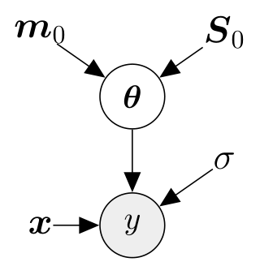
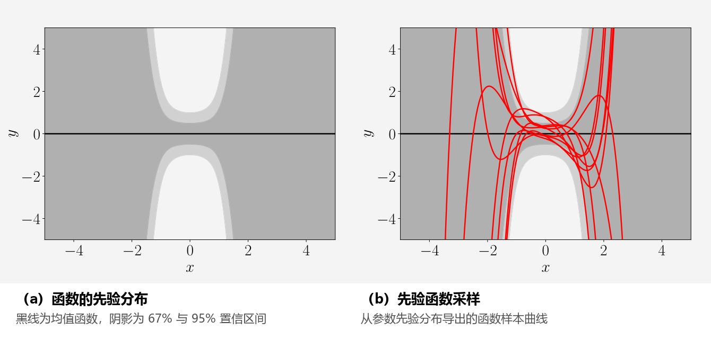
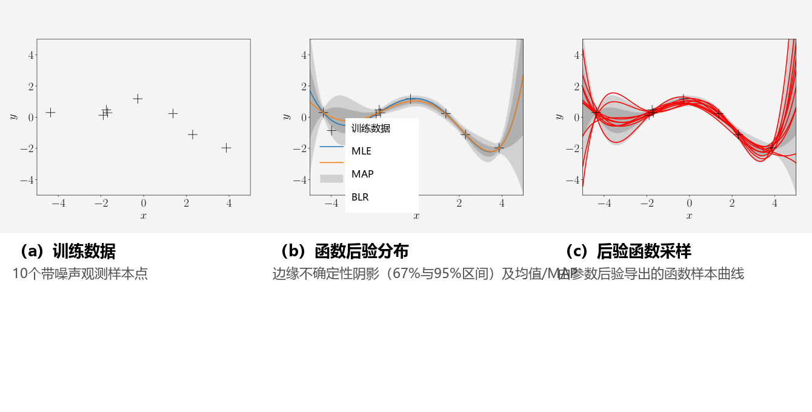
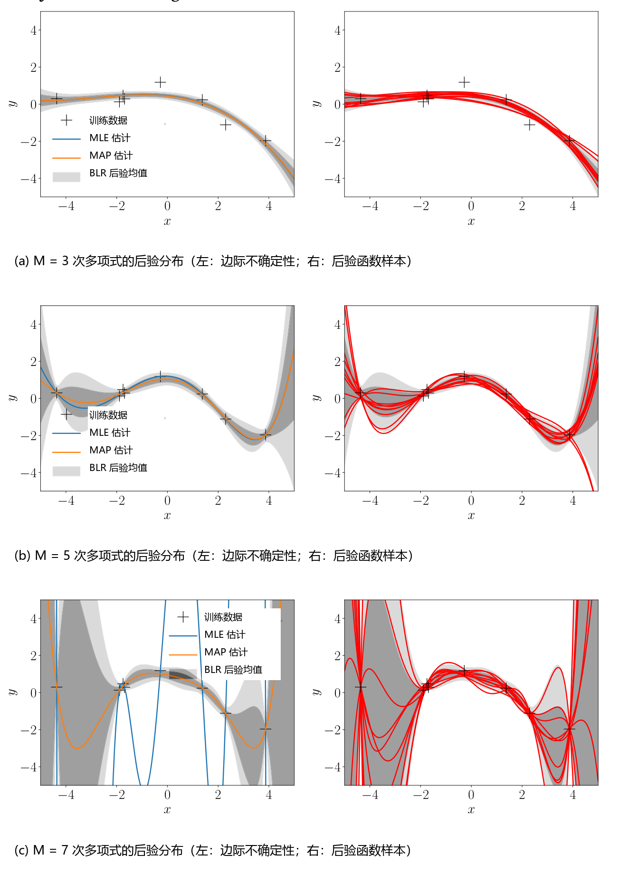

# 9.3 贝叶斯线性回归（Bayesian Linear Regression）

## 本节导学

**学习目标**

1. 掌握模型设定（高斯先验 + 高斯似然，共轭）与先验预测分布 (9.38) 的均值-方差分解；
2. **完整掌握定理 9.1 的配方法证明**——后验 (9.43b)(9.43c) 的推导是全书最重要的代数推导之一；
3. 会写后验预测分布 (9.57)，理解预测均值 = MAP、预测方差 = 参数不确定性 + 噪声；
4. 理解"函数上的分布"（参数分布 ⟹ 函数分布）与置信区间的意义；
5. 掌握边缘似然 (9.64) 的两步推导（高斯性 + 矩计算）。

**预备知识**：9.2 节、6.5 节（高斯边缘/条件）、6.6.1 节（共轭）、8.4.2 节（贝叶斯推断）、8.6.2 节（模型证据）。

**符号速查表**：

| 符号 | 含义 |
| --- | --- |
| $\boldsymbol m_0, \boldsymbol S_0$ | 参数先验的均值与协方差 |
| $\boldsymbol m_N, \boldsymbol S_N$ | 参数后验的均值与协方差（下标 $N$ = 样本量） |
| $p(\mathcal Y \mid \mathcal X)$ | 边缘似然 / 模型证据 (9.42) |
| 配方法 | 把二次型整理成 $(\boldsymbol x - \boldsymbol\mu)^\top\boldsymbol\Sigma(\cdot) + \text{const}$，匹配系数 |

---

## 9.3.1 模型

**先验 + 似然**（图 9.8）：

$$
p(\boldsymbol\theta) = \mathcal N(\boldsymbol\theta \mid \boldsymbol m_0, \boldsymbol S_0), \qquad p(y \mid \boldsymbol x, \boldsymbol\theta) = \mathcal N\big(y \mid \boldsymbol\phi^\top(\boldsymbol x)\boldsymbol\theta, \sigma^2\big) \tag{9.35}
$$

参数 $\boldsymbol\theta$ 被先验**转化为随机变量**。联合分布：$p(y, \boldsymbol\theta \mid \boldsymbol x) = p(y \mid \boldsymbol x, \boldsymbol\theta)p(\boldsymbol\theta)$（(9.36)）。

  
  
<b>图 9.8</b> 贝叶斯线性回归的图模型：θ 带高斯先验，成为随机变量。

## 9.3.2 先验预测

**先验预测分布**（边缘化参数，(9.37)）：

$$
p(y_* \mid \boldsymbol x_*) = \int p(y_* \mid \boldsymbol x_*, \boldsymbol\theta)\, p(\boldsymbol\theta)\,\mathrm d\boldsymbol\theta = \mathbb E_{\boldsymbol\theta}\big[p(y_* \mid \boldsymbol x_*, \boldsymbol\theta)\big] = \mathcal N\big(y_* \mid \boldsymbol\phi^\top(\boldsymbol x_*)\boldsymbol m_0,\ \boldsymbol\phi^\top(\boldsymbol x_*)\boldsymbol S_0\boldsymbol\phi(\boldsymbol x_*) + \sigma^2\big) \tag{9.37, 9.38}
$$

**三个依据**：① 共轭 + 高斯边缘化性质 ⟹ 预测必为高斯；② 方差分解 $\mathbb V[y_*] = \mathbb V_{\boldsymbol\theta}[\boldsymbol\phi^\top\boldsymbol\theta] + \mathbb V_\epsilon[\epsilon]$（(9.39)，噪声与参数独立）；③ $y_*$ 是 $\boldsymbol\theta$ 的**仿射变换**，直接套用均值/协方差法则 (6.50)(6.51)。

**方差两项的物理意义**：$\boldsymbol\phi^\top(\boldsymbol x_*)\boldsymbol S_0\boldsymbol\phi(\boldsymbol x_*)$ = **参数不确定性**；$\sigma^2$ = **测量噪声**。预测无噪声函数值 $f(\boldsymbol x_*)$ 时去掉后者 (9.40)。

> **备注（函数上的分布）**：从 $p(\boldsymbol\theta)$ 抽 $\boldsymbol\theta_i$，画出函数 $f_i(\cdot) = \boldsymbol\theta_i^\top\boldsymbol\phi(\cdot)$——参数分布**诱导出函数分布** $p(f(\cdot))$。记号 $(\cdot)$ 强调这是函数映射。♦

> **例 9.7（函数先验）**。5 阶多项式 + $p(\boldsymbol\theta) = \mathcal N(\boldsymbol 0, \frac14\boldsymbol I)$。图 9.9：阴影 = 67%/95% 置信带（完全来自参数不确定性，无噪声项），曲线族 = 先验函数样本。注意此时**还不需要任何训练数据**。

  
  
<b>图 9.9</b> 函数上的先验分布：(a) 均值函数（黑线）与边际不确定性（67%/95% 置信带）；(b) 先验函数样本。

## 9.3.3 后验分布（定理 9.1，配方法完整证明）

**定理 9.1**。模型 (9.35) 下，参数后验是均值为 $\boldsymbol m_N$、协方差为 $\boldsymbol S_N$ 的高斯分布：

$$
\boldsymbol S_N = \big(\boldsymbol S_0^{-1} + \sigma^{-2}\boldsymbol\Phi^\top\boldsymbol\Phi\big)^{-1}, \qquad \boldsymbol m_N = \boldsymbol S_N\big(\boldsymbol S_0^{-1}\boldsymbol m_0 + \sigma^{-2}\boldsymbol\Phi^\top\boldsymbol y\big) \tag{9.43}
$$

**证明**（配方法——"识别二次型"的标准技术）：

**第 1 步：对数空间展开**。后验 ∝ 似然 × 先验，取对数（忽略常数）：

$$
\log p(\mathcal Y \mid \mathcal X, \boldsymbol\theta) + \log p(\boldsymbol\theta) = -\frac{1}{2}\Big[\sigma^{-2}(\boldsymbol y - \boldsymbol\Phi\boldsymbol\theta)^\top(\boldsymbol y - \boldsymbol\Phi\boldsymbol\theta) + (\boldsymbol\theta - \boldsymbol m_0)^\top \boldsymbol S_0^{-1}(\boldsymbol\theta - \boldsymbol m_0)\Big] + \text{const} \tag{9.45}
$$

**第 2 步：展开并按 $\boldsymbol\theta$ 的幂次归类**（二次项、一次项、常数项）：

$$
-\frac{1}{2}\Big[\boldsymbol\theta^\top\big(\sigma^{-2}\boldsymbol\Phi^\top\boldsymbol\Phi + \boldsymbol S_0^{-1}\big)\boldsymbol\theta - 2\big(\sigma^{-2}\boldsymbol\Phi^\top\boldsymbol y + \boldsymbol S_0^{-1}\boldsymbol m_0\big)^\top\boldsymbol\theta\Big] + \text{const} \tag{9.46}
$$

（$\sigma^{-2}\boldsymbol y^\top\boldsymbol y$、$\boldsymbol m_0^\top\boldsymbol S_0^{-1}\boldsymbol m_0$ 等不含 $\boldsymbol\theta$ 的项全部并入 const。）

**第 3 步：识别高斯**。对数后验是**负二次型** ⟹ 后验必为高斯。把它与标准形式对照：

$$
\log \mathcal N(\boldsymbol\theta \mid \boldsymbol m_N, \boldsymbol S_N) = -\frac{1}{2}\big[\boldsymbol\theta^\top\boldsymbol S_N^{-1}\boldsymbol\theta - 2\boldsymbol m_N^\top\boldsymbol S_N^{-1}\boldsymbol\theta\big] + \text{const} \tag{9.48}
$$

**第 4 步：系数匹配**（二次项系数 ⟹ 精度矩阵；一次项系数 ⟹ 均值）：

$$
\boldsymbol S_N^{-1} = \sigma^{-2}\boldsymbol\Phi^\top\boldsymbol\Phi + \boldsymbol S_0^{-1}, \qquad \boldsymbol m_N^\top\boldsymbol S_N^{-1} = \big(\sigma^{-2}\boldsymbol\Phi^\top\boldsymbol y + \boldsymbol S_0^{-1}\boldsymbol m_0\big)^\top \tag{9.49, 9.50}
$$

整理即得 (9.43b)(9.43c)。$\blacksquare$

> **备注（配方法通用模板）**。形如 $\boldsymbol x^\top\boldsymbol A\boldsymbol x - 2\boldsymbol a^\top\boldsymbol x + c_1$（$\boldsymbol A$ 对称正定）的式子，恒等于 $(\boldsymbol x - \boldsymbol\mu)^\top\boldsymbol\Sigma(\boldsymbol x - \boldsymbol\mu) + c_2$，其中 $\boldsymbol\Sigma = \boldsymbol A$、$\boldsymbol\mu = \boldsymbol\Sigma^{-1}\boldsymbol a$、$c_2 = c_1 - \boldsymbol\mu^\top\boldsymbol\Sigma\boldsymbol\mu$（(9.51)–(9.54)）。本推导中 $\boldsymbol A = \sigma^{-2}\boldsymbol\Phi^\top\boldsymbol\Phi + \boldsymbol S_0^{-1}$、$\boldsymbol a = \sigma^{-2}\boldsymbol\Phi^\top\boldsymbol y + \boldsymbol S_0^{-1}\boldsymbol m_0$（(9.55)(9.56)）。**把多项式按二次/一次/常数归类，配方法就只剩系数匹配**——这是多元高斯推导中最重要的代数技术（第 11 章 GMM、高斯过程都要反复用到）。♦

**后验的直觉解读**（对照 6.5.2 节高斯乘积公式 (6.74)(6.75)）：

- **精度相加**：$\boldsymbol S_N^{-1} = \boldsymbol S_0^{-1} + \sigma^{-2}\boldsymbol\Phi^\top\boldsymbol\Phi$——先验精度 + 数据精度（$\sigma^{-2}\boldsymbol\Phi^\top\boldsymbol\Phi$ 是似然的"信息贡献"）；
- **精度加权平均**：$\boldsymbol m_N$ 是先验均值与数据证据 $\boldsymbol\Phi^\top\boldsymbol y$ 按各自精度的加权折中；
- **数据增多 → $\boldsymbol S_N$ 缩小**：后验越来越集中——贝叶斯版本的"大数定律"。

## 9.3.4 后验预测

把 (9.37) 中的先验换成后验（先验与后验都是高斯，推导完全平行）：

$$
p(y_* \mid \mathcal X, \mathcal Y, \boldsymbol x_*) = \mathcal N\big(y_* \mid \boldsymbol\phi^\top(\boldsymbol x_*)\boldsymbol m_N,\ \boldsymbol\phi^\top(\boldsymbol x_*)\boldsymbol S_N\boldsymbol\phi(\boldsymbol x_*) + \sigma^2\big) \tag{9.57}
$$

**三个要点**：

1. **预测均值 = MAP 估计**：$\boldsymbol\phi^\top(\boldsymbol x_*)\boldsymbol m_N = \boldsymbol\phi^\top(\boldsymbol x_*)\boldsymbol\theta_{\text{MAP}}$——贝叶斯预测的"中心"与 MAP 点估计重合（高斯分布的均值 = 众数）；
2. **预测方差 = 残余参数不确定性 + 噪声**：数据点附近的 $\boldsymbol\phi^\top\boldsymbol S_N\boldsymbol\phi$ 小（数据约束强），远离数据的区域大——**模型自动给出"哪里不确定"**；
3. $\boldsymbol S_N$ 通过 $\boldsymbol\Phi$ 依赖训练输入的位置——不确定性是**输入依赖**的。

> **备注（边缘似然 vs 后验预测）**：两者形式相似（都是"对参数分布平均似然"），区别：(i) 边缘似然预测的是**训练目标** $\boldsymbol y$，后验预测预测**测试目标** $y_*$；(ii) 边缘似然关于**先验**平均，后验预测关于**后验**平均。♦

**无噪声函数值**（(9.58)(9.59)）：均值同 (9.57)（噪声零均值），方差去掉 $\sigma^2$——残余不确定性全部来自参数后验。

> **例 9.8（函数后验，图 9.10）**。例 9.7 的先验 + 数据 → 函数后验：均值函数 = MAP 曲线；置信带在数据点处收窄、在边界与数据稀疏区急剧展宽；后验函数样本彼此高度一致（低阶时）。(图 9.11 对 $M = 3, 5, 7$：阶数越高，参数约束越弱，样本函数越发散、不确定性带越宽。）

  
  
<b>图 9.10</b> 函数上的后验分布：(a) 训练数据；(b) 后验分布（MLE/MAP 函数与置信带）；(c) 后验函数样本。

  
  
<b>图 9.11</b> 贝叶斯线性回归对比（左：置信带；右：后验函数采样）：(a) M = 3；(b) M = 5；(c) M = 7。

**为什么这很重要**：7 阶时 MAP 曲线"看起来不错"，但贝叶斯模型额外告诉我们——**无数据区域的后验不确定性极大**。在强化学习/机器人控制中，盲目自信的预测可能致命（8.4 节备注，Deisenroth et al., 2015）——不确定性信息本身就是决策资源。

## 9.3.5 计算边缘似然

8.6.2 节说边缘似然是贝叶斯模型选择的核心——现在把它算出来。

**数据生成过程**（(9.60)）：$\boldsymbol\theta \sim \mathcal N(\boldsymbol m_0, \boldsymbol S_0)$，$y_n \mid \boldsymbol x_n, \boldsymbol\theta \sim \mathcal N(\boldsymbol x_n^\top\boldsymbol\theta, \sigma^2)$。

**第 1 步：识别边缘似然是高斯**。两条论据（6.5.2 节）：(i) 两个高斯密度的乘积是未归一化高斯，其归一化常数关于 $\boldsymbol y$ 呈高斯形（(6.76)）；(ii) 高斯的线性变换仍高斯。于是 $p(\mathcal Y \mid \mathcal X) = \mathcal N(\boldsymbol y \mid \cdot, \cdot)$，只需定矩。

**第 2 步：算矩**（$\boldsymbol y = \boldsymbol X\boldsymbol\theta + \boldsymbol\epsilon$，仿射变换法则 (6.50)(6.51) + 噪声独立）：

$$
\mathbb E_{\boldsymbol\theta}[\mathcal Y \mid \mathcal X] = \boldsymbol X\,\mathbb E[\boldsymbol\theta] + \mathbb E[\boldsymbol\epsilon] = \boldsymbol X\boldsymbol m_0 \tag{9.62}
$$

$$
\operatorname{Cov}[\mathcal Y \mid \mathcal X] = \boldsymbol X\operatorname{Cov}(\boldsymbol\theta)\boldsymbol X^\top + \operatorname{Cov}(\boldsymbol\epsilon) = \boldsymbol X\boldsymbol S_0\boldsymbol X^\top + \sigma^2\boldsymbol I \tag{9.63}
$$

**结论**：

$$
p(\mathcal Y \mid \mathcal X) = \mathcal N\big(\boldsymbol y \mid \boldsymbol X\boldsymbol m_0,\ \boldsymbol X\boldsymbol S_0\boldsymbol X^\top + \sigma^2\boldsymbol I\big) \tag{9.64}
$$

**解读**：边缘似然的均值 = 先验下的期望预测；协方差 = 参数不确定性的传播（$\boldsymbol X\boldsymbol S_0\boldsymbol X^\top$）+ 观测噪声（$\sigma^2\boldsymbol I$）。与后验预测 (9.57) 对照——同一个"先验/后验 + 噪声"结构，这正是 8.6.2 节"边缘似然自动奥卡姆剃刀"的计算载体：**用它对不同阶数 $M$ 的多项式打分，无需交叉验证即可选模型**。

---

## 本节小结

| 对象 | 公式 | 一句话 |
| --- | --- | --- |
| 后验 | $\boldsymbol S_N^{-1} = \boldsymbol S_0^{-1} + \sigma^{-2}\boldsymbol\Phi^\top\boldsymbol\Phi$；$\boldsymbol m_N = \boldsymbol S_N(\boldsymbol S_0^{-1}\boldsymbol m_0 + \sigma^{-2}\boldsymbol\Phi^\top\boldsymbol y)$ | 精度相加、精度加权（配方法） |
| 后验预测 | $\mathcal N(\boldsymbol\phi^\top\boldsymbol m_N,\ \boldsymbol\phi^\top\boldsymbol S_N\boldsymbol\phi + \sigma^2)$ | 均值 = MAP；方差 = 参数不确定性 + 噪声 |
| 边缘似然 | $\mathcal N(\boldsymbol y \mid \boldsymbol X\boldsymbol m_0,\ \boldsymbol X\boldsymbol S_0\boldsymbol X^\top + \sigma^2\boldsymbol I)$ | 模型选择的打分函数 |

**与其他章节的关系**：配方法是第 11 章 GMM 的 EM 推导与第 10.7 节概率 PCA 的基本功；"函数上的分布"概念直通高斯过程（9.5 节）；边缘似然 (9.64) 是 8.6.2 节理论的第一个完整实例。
