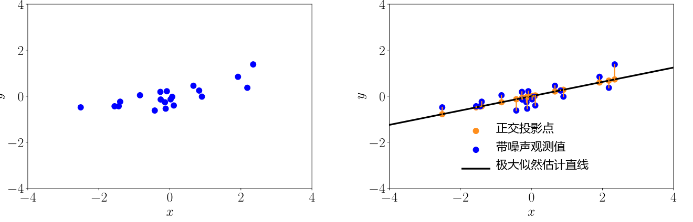

# 9.4 极大似然作为正交投影（Maximum Likelihood as Orthogonal Projection）

## 本节导学

**学习目标**：为 (9.12c)(9.19) 的代数解赋予几何意义——MLE = 把观测向量 $\boldsymbol y$ 正交投影到输入/特征张成的子空间上；并理解标准正交基下投影的"解耦"特例。

**预备知识**：3.8 节（正交投影，尤其 3.46 一维公式与 3.59 一般公式）、2.6 节（列空间）、9.2 节。

---

## 9.4.1 一维情形：投影到一条直线

**设定**（过原点的直线，无特征映射）：

$$
y = x\theta + \epsilon, \qquad \mathcal N(0, \sigma^2) \tag{9.65}
$$

$\boldsymbol X = [x_1, \ldots, x_N]^\top \in \mathbb R^N$ 此时是**列向量**。MLE（(9.12c) 的标量版）：

$$
\theta_{\text{ML}} = (\boldsymbol X^\top\boldsymbol X)^{-1}\boldsymbol X^\top \boldsymbol y = \frac{\boldsymbol X^\top \boldsymbol y}{\boldsymbol X^\top \boldsymbol X} \in \mathbb R \tag{9.66}
$$

**重构**（对训练输入的最佳预测）：

$$
\boldsymbol X\theta_{\text{ML}} = \boldsymbol X\,\frac{\boldsymbol X^\top \boldsymbol y}{\boldsymbol X^\top \boldsymbol X} = \frac{\boldsymbol X\boldsymbol X^\top}{\boldsymbol X^\top \boldsymbol X}\,\boldsymbol y \tag{9.67}
$$

**对照 3.8 节的投影公式**——(9.67) 中的三个对象各就各位：

- $\frac{\boldsymbol X\boldsymbol X^\top}{\boldsymbol X^\top \boldsymbol X}$ 是**投影矩阵**（对照一维投影矩阵 $\frac{\boldsymbol b\boldsymbol b^\top}{\|\boldsymbol b\|^2}$，(3.46)——一模一样！）；
- $\theta_{\text{ML}}$ 是投影在 $\operatorname{span}[\boldsymbol X]$ 这个一维子空间中的**坐标**（唯一数）；
- $\boldsymbol X\theta_{\text{ML}}$ 是 $\boldsymbol y$ 在该子空间上的**正交投影向量**。

**几何叙述**：MLE 在由 $\boldsymbol X$ 张成的子空间中找与 $\boldsymbol y$ **最近**的向量——"最近" = 残差平方和最小（这正是投影的定义性质，3.8 节）。图 9.12(b)：带噪声观测被投到子空间上，投影点与原数据集的平方距离最小——**极大似然解就是几何最优解**。

  
  
<b>图 9.12</b> 最小二乘的几何解释：(a) 数据集；(b) 解释为投影的极大似然解。

## 9.4.2 一般情形：投影到 $K$ 维列空间

带特征映射的模型 (9.68)：$\boldsymbol y \approx \boldsymbol\Phi\boldsymbol\theta_{\text{ML}}$（(9.69)），$\boldsymbol\theta_{\text{ML}} = (\boldsymbol\Phi^\top\boldsymbol\Phi)^{-1}\boldsymbol\Phi^\top\boldsymbol y$（(9.70)）。

**几何解读**：$\boldsymbol\Phi\boldsymbol\theta_{\text{ML}}$ 是 $\boldsymbol y$ 向 $\mathbb R^N$ 中由 $\boldsymbol\Phi$ 的 $K$ 个列向量张成的子空间（列空间）上的正交投影——与 3.8.2 节的一般投影公式 (3.58)(3.59) 逐字对应。这也解释了 9.2.1 节的"可逆条件"：$\operatorname{rk}(\boldsymbol\Phi) = K$ ⟺ 列线性无关 ⟺ 投影目标子空间维数确实是 $K$。

**标准正交基的解耦特例**。若特征 $\phi_k$ **标准正交**（$\boldsymbol\Phi^\top\boldsymbol\Phi = \boldsymbol I$，3.5 节），投影矩阵 (9.71) 简化为：

$$
\boldsymbol\Phi(\boldsymbol\Phi^\top\boldsymbol\Phi)^{-1}\boldsymbol\Phi^\top\boldsymbol y = \boldsymbol\Phi\boldsymbol\Phi^\top\boldsymbol y = \Big(\sum_{k=1}^K \boldsymbol\phi_k\boldsymbol\phi_k^\top\Big)\boldsymbol y
$$

——**各特征间的耦合完全消失**：MLE 投影 = 把 $\boldsymbol y$ 逐个投向每个基向量 $\boldsymbol\phi_k$ 再叠加。信号处理的常用基（小波、傅里叶）都是正交基；非正交基可用格拉姆-施密特正交化（3.8.3 节，Strang 2003）转化为正交基。

**本章的三种视角至此合流**：优化视角（最小化 NLL）、概率视角（高斯似然）、几何视角（正交投影）——同一件事的三种语言，在后续章节会反复互换使用。

---

## 本节小结

| 视角 | 内容 |
| --- | --- |
| 优化 | $\min_{\boldsymbol\theta}\|\boldsymbol y - \boldsymbol\Phi\boldsymbol\theta\|^2$ |
| 概率 | 高斯似然下 MLE |
| 几何 | $\boldsymbol y$ 向 $\operatorname{span}[\boldsymbol\Phi]$ 的正交投影；(9.67) 的投影矩阵 = (3.46) |

**与其他章节的关系**：10.3 节 PCA 的"投影视角"与本节同源（把数据投到主子空间）；3.8.2 节的正规方程在此兑现；正交基解耦是信号处理与函数逼近（3.7 节傅里叶）的桥梁。
